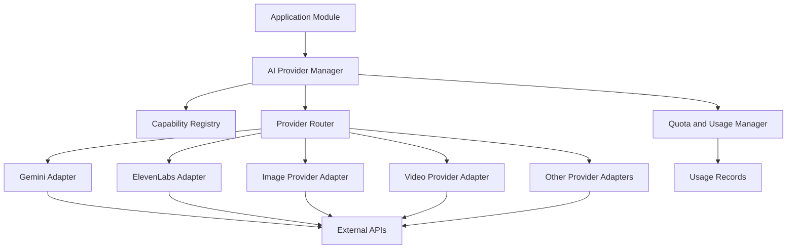

# AI Video Studio
## API Provider Integration Specification — Version 1.0

**Document status:** Initial integration specification  
**Version:** 1.0  
**Last reviewed:** 2 November 2026  
**Architecture:** API-first, provider-independent  
**Initial strategy:** Free-tier-first development  
**Backend:** Node.js + Express + TypeScript  
**Database:** MongoDB  
**Job processing:** BullMQ + Redis-compatible infrastructure  
**Video composition:** Remotion  
**Media processing:** FFmpeg

---

# 1. Introduction

This document defines the external AI APIs and services that AI Video Studio will integrate with.

AI Video Studio will not run AI models locally. All AI capabilities will be accessed through hosted APIs.

The system must support multiple providers for each capability so that providers can be replaced, disabled or added without rewriting the application.

The initial objective is to build and test the complete product using free-tier access wherever available.

Paid services will only be introduced when necessary and after explicit approval.

## 1.1 Objectives

- Identify suitable AI API providers.
- Prioritize free-tier access.
- Support multiple providers.
- Establish provider integration standards.
- Manage API credentials securely.
- Track quotas and usage.
- Handle rate limits and provider failures.
- Support fallback providers.
- Monitor API costs.
- Protect user content.
- Prepare for commercial SaaS deployment.

# 2. Provider Categories

The platform requires the following provider categories.

| Category | Purpose |
|---|---|
| LLM | Script generation, content understanding and AI assistance |
| Document AI | PDF and presentation understanding |
| Image generation | Generate scene images and illustrations |
| Video generation | Generate short AI video clips |
| Text-to-speech | Generate voiceovers |
| Speech-to-text | Transcribe audio and video |
| Translation | Translate scripts and subtitles |
| Music generation | Generate background music |
| Sound effects | Generate sound effects |
| Media search | Find suitable stock visuals |
| Video processing | Compose, encode and process videos |

# 3. Initial Provider Selection

The following is the proposed provider strategy. A provider being listed does not mean its free tier is guaranteed or that every capability is available without payment.

| Capability | Initial provider | Development decision |
|---|---|---|
| Text and LLM | Gemini API | Primary |
| Document understanding | Gemini API | Primary |
| Script generation | Gemini API | Primary |
| Storyboard generation | Gemini API | Primary |
| Image generation | Hosted image APIs | Evaluate free access |
| Video generation | Hosted video APIs | Evaluate separately |
| Voice generation | ElevenLabs | Test free allowance |
| Speech-to-text | Gemini / ElevenLabs | Evaluate |
| Translation | Gemini | Primary |
| Music generation | ElevenLabs Music / alternatives | Optional |
| Sound effects | ElevenLabs / alternatives | Optional |
| Motion graphics | Remotion | Primary |
| Video processing | FFmpeg | Primary |
| Media storage | Local storage initially | Primary |

## 3.1 Important distinction

The system must distinguish between:

- Free API access.
- Free web application access.
- Free trial credits.
- Free API usage with limited quotas.
- Paid API access.
- Commercial-use licensing.

A provider may offer a free website without providing free API access.

We must verify actual API access before implementing an integration.

# 4. Provider 1 — Gemini API

**Provider:** Google  
**Category:** LLM, document understanding and multimodal AI  
**Website:** https://ai.google.dev/

## 4.1 Responsibilities

Gemini will initially power the content intelligence capabilities of AI Video Studio.

Use cases:

1. Prompt understanding.
2. Document understanding.
3. Content summarization.
4. Script generation.
5. Storyboard generation.
6. Scene descriptions.
7. Visual prompt generation.
8. Script rewriting.
9. Translation.
10. Subtitle translation.
11. AI assistant.
12. Video content analysis where supported.

## 4.2 Integration strategy

Use the official Gemini API through a backend provider adapter.

The frontend must never communicate directly with Gemini using a private API key.

All requests must pass through:

```text
Frontend
   |
   v
Express Backend
   |
   v
AI Provider Manager
   |
   v
Gemini Adapter
   |
   v
Gemini API
```

## 4.3 Free-tier strategy

Gemini offers free access to selected models with limited rate limits.

The free tier is suitable for initial development and experimentation.

However:

- Not all models are free.
- Rate limits vary by model.
- Limits may change.
- Free-tier content may be used by Google to improve its products.
- Paid-tier data handling differs from the free tier.

Do not send confidential business documents or sensitive user content through the free tier without appropriate user disclosure and consent.

## 4.4 Initial implementation priority

<badge color="success">Primary integration</badge>

Implement Gemini first.

Use it to complete the initial prompt-to-script-to-storyboard workflow.

## 4.5 Official documentation

- https://ai.google.dev/gemini-api/docs
- https://ai.google.dev/gemini-api/docs/pricing
- https://ai.google.dev/gemini-api/docs/rate-limits

# 5. Provider 2 — ElevenLabs

**Provider:** ElevenLabs  
**Category:** Voice, speech, audio and sound generation  
**Website:** https://elevenlabs.io/

## 5.1 Responsibilities

ElevenLabs may provide:

- Text-to-speech.
- AI voice generation.
- Voice selection.
- Speech-to-text.
- Audio transcription.
- Sound effects.
- Music generation.
- Voice transformation.
- Dubbing.

## 5.2 Initial integration

Prioritize text-to-speech.

The workflow:

```text
Approved Script
      |
      v
Voice Provider Adapter
      |
      v
ElevenLabs API
      |
      v
Generated Audio
      |
      v
Storage
      |
      v
Remotion Timeline
```

## 5.3 Free-tier strategy

The currently listed Free plan includes 10,000 monthly credits.

The credit pool is shared across products. Different operations consume different quantities.

For example:

- Text-to-speech consumes credits based on generated characters and model.
- Speech-to-text consumes credits based on audio duration.
- Music generation and sound effects also consume credits.

The free allowance should initially be reserved for testing voice generation.

Do not assume the free plan grants commercial rights. Verify the applicable commercial-use terms before using generated audio in a paid SaaS or distributing commercial customer videos.

## 5.4 Implementation priority

<badge color="success">Primary integration</badge>

Implement voice generation after Gemini.

## 5.5 Official documentation

- https://elevenlabs.io/docs
- https://elevenlabs.io/pricing
- https://elevenlabs.io/docs/api-reference

# 6. Image Generation Providers

Image generation is required for:

- Explainer videos.
- Educational illustrations.
- Background images.
- Scene artwork.
- Characters.
- Product visuals.
- Infographics.
- Thumbnail images.

## 6.1 Provider strategy

Evaluate hosted image-generation APIs based on:

- Actual API access.
- Free credits or trial availability.
- Output quality.
- Resolution.
- Image editing support.
- Reference-image support.
- Character consistency.
- Commercial licensing.
- Data retention.
- API reliability.

Potential providers to evaluate:

- Google Gemini image-generation models.
- Other hosted image-generation providers with suitable API access.
- Hosted inference platforms that expose image models.

## 6.2 Gemini image-generation consideration

Gemini text generation and Gemini image generation must be treated as separate capabilities.

Do not assume that a free Gemini text model also provides free image generation.

The current published pricing for the listed Nano Banana image-generation model does not show free-tier access.

Therefore, image generation must have an independent provider configuration and usage budget.

## 6.3 Initial implementation priority

<badge color="warning">Evaluate before integration</badge>

For the first MVP, support:

1. User-uploaded images.
2. Reusable media-library images.
3. Remotion-generated graphics.
4. AI image generation through a configured provider when access is available.

This allows the product to work even without a free image-generation API.

# 7. Video Generation Providers

Video generation is one of the most expensive and technically demanding capabilities.

Use cases:

- Text-to-video.
- Image-to-video.
- Short cinematic clips.
- Animated scenes.
- AI footage.
- Product demonstrations.
- Background footage.

## 7.1 Provider evaluation

Evaluate hosted video-generation APIs based on:

- API availability.
- Free credits.
- Price per generation or video duration.
- Maximum video duration.
- Resolution.
- Aspect ratio.
- Image-to-video support.
- Reference-image support.
- Audio generation.
- Job polling and webhooks.
- Download and retention rules.
- Commercial usage rights.

Potential providers to evaluate include:

- Google video-generation services where supported through currently available GA APIs.
- Runway API.
- Other hosted video-generation API platforms.
- Hosted inference providers offering video models.

## 7.2 Important Google API decision

Do not integrate retired Veo 3.1 Preview endpoint identifiers.

Provider adapters must use currently supported model identifiers and endpoints.

## 7.3 Free-tier strategy

Do not assume a free video-generation API will be available.

For the initial MVP, video generation should be optional.

Use:

- Remotion animation.
- User-uploaded video clips.
- Existing licensed media.
- AI-generated images with motion effects.

Add hosted AI video generation after confirming an accessible API and acceptable usage cost.

## 7.4 Implementation priority

<badge color="warning">Later integration</badge>

Do not make AI video generation a dependency of the first working MVP.

# 8. Speech-to-Text Providers

Speech-to-text is needed for:

- Audio-to-video.
- Video transcription.
- Subtitle generation.
- Uploaded narration.
- Meeting or lecture conversion.
- Document-to-course workflows involving recordings.

## 8.1 Provider options

Initial candidates:

- Gemini multimodal audio capabilities where supported.
- ElevenLabs Speech-to-Text API.
- Other hosted speech recognition APIs.

## 8.2 Requirements

The selected provider should support:

- Audio file input.
- Timestamped transcription where available.
- Multiple languages.
- Reasonable accuracy.
- Long recordings or chunked processing.
- Supported upload formats.
- Clear API quotas.

## 8.3 Initial strategy

Start with the most convenient eligible API already configured.

Avoid introducing an additional paid provider unless required.

# 9. Translation Providers

Translation will support multilingual video creation.

Required functionality:

- Script translation.
- Subtitle translation.
- Title translation.
- Description translation.
- Multi-language voiceover preparation.

## Initial provider

Use Gemini initially.

The provider manager should allow a dedicated translation API to be added later if translation quality or throughput requires it.

# 10. Music and Sound Effects Providers

Audio capabilities will improve the quality of generated videos.

Required capabilities:

- Background music.
- Intro music.
- Outro music.
- Ambient sound.
- Cinematic sound effects.
- Notification sounds.
- Transition effects.
- Scene-specific audio.

## Provider strategy

Evaluate ElevenLabs audio-generation capabilities and other hosted audio APIs.

Track music and sound-effect credits independently by operation.

The MVP must also support user-uploaded audio and properly licensed music.

Do not automatically use copyrighted commercial music.

# 11. Media Search and Stock Assets

Not every scene needs AI-generated visuals.

The platform should support stock and licensed media.

Potential integrations can include media providers with documented APIs and clear usage terms.

Requirements:

- Search images.
- Search videos.
- Retrieve thumbnails.
- Retrieve metadata.
- Store source attribution.
- Track licence information.
- Record the source URL.
- Respect provider download restrictions.

Only integrate providers after confirming API access and permitted use.

# 12. Provider Capability Matrix

The provider manager must maintain a capability registry.

Example:

| Provider | Text | Image | Video | Voice | STT | Music |
|---|---|---|---|---|---|---|
| Gemini | Yes | Model-dependent | Current endpoint check | Model-dependent | Model-dependent | Not primary |
| ElevenLabs | Limited | Model-dependent product | Product-dependent | Yes | Yes | Yes |
| Other hosted providers | Provider-dependent | Provider-dependent | Provider-dependent | Provider-dependent | Provider-dependent | Provider-dependent |

This matrix must be configurable rather than permanently hardcoded.

# 13. API Provider Manager Architecture

All provider integrations must go through a centralized service.

## 13.1 Main responsibilities

- Provider registration.
- Provider configuration.
- API credential management.
- Model selection.
- Capability checking.
- Request routing.
- Usage tracking.
- Quota management.
- Rate-limit handling.
- Error handling.
- Retry management.
- Fallback selection.
- Provider health monitoring.

## 13.2 Architecture



# 14. Standard Provider Interface

Every provider must implement a common internal contract.

Example:

```typescript
export type ProviderCapability =
  | "llm"
  | "document-understanding"
  | "image-generation"
  | "video-generation"
  | "text-to-speech"
  | "speech-to-text"
  | "translation"
  | "music-generation"
  | "sound-effects";

export interface ProviderMetadata {
  id: string;
  name: string;
  capabilities: ProviderCapability[];
  enabled: boolean;
}

export interface ProviderRequest {
  userId: string;
  workspaceId: string;
  projectId?: string;
  sceneId?: string;

  capability: ProviderCapability;
  model?: string;

  input: Record<string, unknown>;
  options?: Record<string, unknown>;
}

export interface ProviderResponse {
  providerId: string;
  model?: string;

  status: "completed" | "processing";

  output?: Record<string, unknown>;

  externalJobId?: string;

  usage?: {
    inputTokens?: number;
    outputTokens?: number;
    characters?: number;
    durationSeconds?: number;
  };

  estimatedCost?: number;
}

export interface AIProvider {
  metadata: ProviderMetadata;

  isAvailable(): Promise<boolean>;

  execute(
    request: ProviderRequest
  ): Promise<ProviderResponse>;
}
```

This is an internal application contract, not a requirement imposed on external APIs.

Each adapter is responsible for converting internal requests into the provider's specific format.

# 15. Provider Routing Strategy

The application should select a provider based on:

1. Requested capability.
2. Enabled status.
3. Supported model.
4. Available quota.
5. User usage limits.
6. Provider health.
7. Cost constraints.
8. Quality requirements.
9. Commercial-use eligibility.

Example:

```text
Request: Generate Voice
       |
       v
Provider Manager
       |
       v
Check Enabled Providers
       |
       v
Check Available Credits
       |
       v
Check Commercial Permissions
       |
       v
Select Eligible Provider
       |
       v
Execute API Request
       |
       v
Record Usage
       |
       v
Return Result
```

A fallback provider must support the requested capability and acceptable output requirements.

# 16. API Key Management

## 16.1 Development

Store API keys in environment variables.

Example:

```env
# Gemini
GEMINI_API_KEY=

# ElevenLabs
ELEVENLABS_API_KEY=

# Additional providers
IMAGE_PROVIDER_API_KEY=
VIDEO_PROVIDER_API_KEY=
STT_PROVIDER_API_KEY=

# Application
MONGODB_URI=
REDIS_URL=
JWT_SECRET=
```

Do not commit `.env` files.

Maintain `.env.example` with placeholder values only.

## 16.2 Production

Use a managed secrets service.

Requirements:

- Encryption at rest.
- Restricted access.
- Credential rotation.
- Access auditing.
- No secret exposure in logs.
- No secret exposure in API responses.
- Separate credentials for different environments where appropriate.

## 16.3 User-provided API keys

Initially, API keys will be managed by the platform administrator.

Future versions may support user-provided API credentials.

If introduced, user keys must be encrypted, isolated and protected from other workspace members.

# 17. Usage Tracking and Quota Management

Every API request must be recorded.

Required usage fields:

```typescript
interface UsageRecord {
  userId: string;
  workspaceId: string;

  projectId?: string;
  sceneId?: string;

  providerId: string;
  capability: string;
  model?: string;

  requestId: string;

  inputUnits?: number;
  outputUnits?: number;

  estimatedCost?: number;
  currency?: string;

  status: "success" | "failed";

  createdAt: Date;
}
```

## 17.1 Usage controls

- Monthly user quota.
- Daily request limits.
- Provider-specific limits.
- Concurrent job limits.
- Maximum generation duration.
- Maximum upload size.
- Per-project limits.
- Maximum retry count.

## 17.2 Free-tier management

The platform must never assume that free-tier quotas are unlimited.

Implement configurable limits.

When a provider reaches its limit:

1. Stop new requests to that provider.
2. Mark it temporarily unavailable if appropriate.
3. Check for an eligible alternative.
4. Notify the user if no alternative exists.
5. Allow the user to retry later.

Do not automatically switch to a paid provider unless the user or administrator has authorized paid usage.

# 18. Rate Limits and Retry Strategy

Handle common provider errors:

| Error | Action |
|---|---|
| 401 Unauthorized | Check API credentials |
| 403 Forbidden | Check account permissions |
| 404 Not Found | Check endpoint or model identifier |
| 429 Rate Limited | Respect retry instructions |
| 500 Server Error | Retry with backoff if safe |
| 503 Unavailable | Retry or use eligible fallback |
| Timeout | Check provider job status before resubmission |

Retry rules:

- Use exponential backoff.
- Add jitter.
- Respect `Retry-After` where provided.
- Limit retry attempts.
- Do not retry permanent errors automatically.
- Use idempotency where supported.

Never submit a second paid generation request merely because the first request timed out. Check the original request status first.

# 19. Asynchronous API Handling

Some providers return a job ID rather than a completed result.

The adapter must support:

- Request submission.
- External job ID storage.
- Status polling.
- Webhook handling.
- Result retrieval.
- Timeout management.
- Cancellation where supported.

Example:

```text
Submit Request
      |
      v
Receive Provider Job ID
      |
      v
Save Job ID
      |
      v
Poll or Receive Webhook
      |
      v
Check Completion
      |
      v
Download Result
      |
      v
Store Asset
```

Webhook endpoints must validate authenticity and prevent duplicate event processing.

# 20. API Security

- All provider calls must originate from the backend.
- API keys must never be sent to the frontend.
- Validate user input before sending it to providers.
- Apply request timeouts.
- Enforce user and workspace authorization.
- Restrict upload access.
- Validate downloaded media.
- Protect against SSRF.
- Redact secrets from logs.
- Apply per-user rate limits.
- Track provider request IDs.
- Respect provider data retention and deletion policies.

# 21. Data Privacy and Commercial Licensing

Each provider must have a recorded compliance profile.

Required fields:

- Provider name.
- Privacy policy URL.
- Terms of service URL.
- Data retention policy.
- Training/data-use policy.
- Commercial-use permission.
- Generated-content ownership terms.
- Attribution requirements.
- Geographic restrictions.
- Current verification date.

Before enabling a provider for commercial customer projects, verify that its current terms permit the intended use.

The free development environment must not be treated as automatically suitable for commercial deployment.

# 22. Provider Configuration Database

Suggested MongoDB collection:

`provider_configs`

Example:

```json
{
  "providerId": "gemini",
  "name": "Gemini",
  "category": "llm",
  "enabled": true,
  "capabilities": [
    "llm",
    "document-understanding",
    "translation"
  ],
  "priority": 1,
  "environment": "development",
  "quota": {
    "monthlyLimit": null,
    "dailyLimit": null
  },
  "commercialEligible": false,
  "lastVerifiedAt": "2026-11-02T00:00:00.000Z"
}
```

Secrets must not be stored as plaintext inside ordinary provider configuration documents.

Use a secrets service or a separately encrypted credential store.

The `commercialEligible` field must only be enabled after licensing has been reviewed.

# 23. Backend Module Structure

Recommended implementation structure:

```text
backend/
  src/
    modules/
      providers/
        providers.module.ts

        interfaces/
          provider.interface.ts

        registry/
          provider.registry.ts

        manager/
          provider.manager.ts

        router/
          provider.router.ts

        adapters/
          llm/
            gemini/
              gemini.adapter.ts

          voice/
            elevenlabs/
              elevenlabs.adapter.ts

          image/
            image.adapter.ts

          video/
            video.adapter.ts

          speech/
            speech.adapter.ts

          audio/
            audio.adapter.ts

        services/
          provider-health.service.ts
          provider-usage.service.ts
          provider-quota.service.ts
          provider-fallback.service.ts

        repositories/
          provider.repository.ts

        controllers/
          provider.controller.ts
```

# 24. Initial Integration Order

We will not integrate every provider at once.

## Phase 1 — Essential integrations

1. Gemini API.
2. ElevenLabs text-to-speech.
3. Remotion.
4. FFmpeg.

Goal: Complete one full prompt-to-video workflow.

## Phase 2 — Additional AI capabilities

1. Image generation provider.
2. Speech-to-text provider.
3. Translation improvements.
4. Audio and sound-effect provider.

Goal: Expand the number of content-generation workflows.

## Phase 3 — Advanced AI generation

1. Video-generation provider.
2. Image-to-video.
3. Advanced character consistency.
4. More voice providers.
5. Additional LLM providers.

Goal: Improve video quality and support more creative workflows.

## Phase 4 — Production and commercial readiness

1. Provider billing integration.
2. Commercial licensing verification.
3. Usage-based subscriptions.
4. Cost dashboards.
5. Provider health monitoring.
6. Automatic provider routing.
7. Enterprise credentials and quotas.

# 25. Provider Evaluation Checklist

Before adding any provider, verify:

- [ ] Official API documentation exists.
- [ ] API access is available.
- [ ] Free-tier or trial eligibility is confirmed.
- [ ] Current rate limits are documented.
- [ ] Pricing is understood.
- [ ] Commercial-use terms are reviewed.
- [ ] Data handling terms are reviewed.
- [ ] API keys can be secured.
- [ ] Required output formats are supported.
- [ ] Asynchronous processing is supported where needed.
- [ ] Failure handling is understood.
- [ ] Provider can be integrated through an adapter.
- [ ] A basic integration test passes.

# 26. Initial MVP Provider Configuration

The first development environment should use:

| Service | Configuration |
|---|---|
| Gemini | Enabled |
| ElevenLabs | Enabled for permitted testing |
| Image generation | Disabled until suitable API access is confirmed |
| Video generation | Disabled until suitable API access is confirmed |
| Speech-to-text | Evaluate after voice integration |
| Translation | Gemini |
| Music generation | Optional |
| Sound effects | Optional |
| Remotion | Enabled |
| FFmpeg | Enabled |
| Local media storage | Enabled |

The MVP must remain functional without image-generation or video-generation API access.

It should use generated motion graphics, templates and uploaded media as alternatives.

# 27. Testing Requirements

Each provider adapter must have:

1. Unit tests.
2. Request validation tests.
3. Authentication failure tests.
4. Rate-limit tests.
5. Timeout tests.
6. Retry tests.
7. Output validation tests.
8. Usage tracking tests.
9. Integration tests using permitted API access.

Mock providers should be available for development so that the application can be tested without consuming real API credits.

# 28. Acceptance Criteria

The API Provider Manager is ready when:

- Gemini can be called through its adapter.
- ElevenLabs can generate audio through its adapter.
- Provider credentials remain on the backend.
- Usage records are created.
- Quota limits are enforced.
- Rate limits are handled.
- Provider failures produce useful errors.
- Additional providers can be registered without changing application modules.
- Mock providers can be used for testing.
- The system does not automatically spend money when a free quota is exhausted.
- Provider licensing eligibility can be checked before commercial generation.

# 29. Final Technical Decisions

The following decisions are approved for the initial development architecture:

1. Gemini will be the primary text and content intelligence provider.
2. ElevenLabs will be the initial voice-generation provider, subject to plan and usage restrictions.
3. Image and video providers will be selected only after verifying actual API access and costs.
4. Remotion will handle video composition.
5. FFmpeg will handle media processing.
6. All AI providers will be accessed through a centralized provider manager.
7. Free-tier access will be prioritized.
8. Paid API usage will require explicit approval.
9. All provider integrations will use adapters.
10. Provider usage, quotas and costs will be tracked.
11. Commercial licensing must be verified before paid SaaS deployment.
12. The platform must continue to work when an optional AI provider is unavailable.

---

# 30. Official Reference Links

### Google Gemini
- API documentation: https://ai.google.dev/gemini-api/docs
- Pricing: https://ai.google.dev/gemini-api/docs/pricing
- Rate limits: https://ai.google.dev/gemini-api/docs/rate-limits

### ElevenLabs
- API documentation: https://elevenlabs.io/docs
- Pricing: https://elevenlabs.io/pricing

### Video and rendering
- Remotion: https://www.remotion.dev/
- Remotion pricing: https://www.remotion.dev/pricing
- FFmpeg: https://ffmpeg.org/documentation.html

### Other provider candidates
- Runway: https://runwayml.com/
- fal: https://fal.ai/
- Replicate: https://replicate.com/

Provider documentation, pricing and licensing must be rechecked before integration.

---

**Document:** API Provider Integration Specification  
**Version:** 1.0  
**Status:** Initial provider strategy established  
**Next document:** Database Design Document