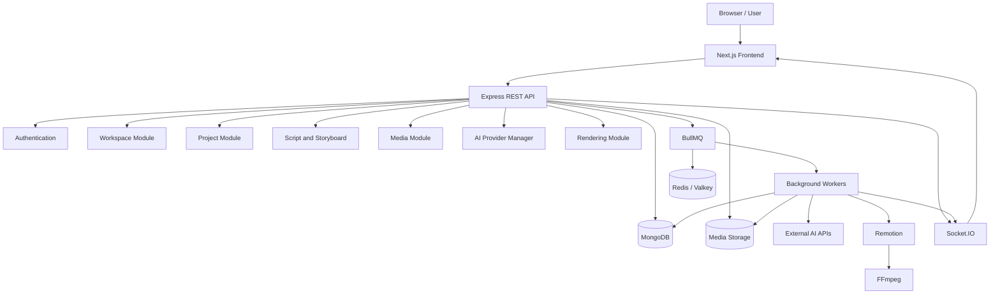

# AI Video Studio
## Backend API Specification — Version 1.0

> Implemented scene editing (4 November 2026): `PATCH /api/v1/scenes/:sceneId/editor` accepts `expectedUpdatedAt`, structured `editing`, `narration` and `visualDescription`. `POST /api/v1/scenes/:sceneId/editor/undo` and `/redo` accept `expectedUpdatedAt`. All require current approved scenes and workspace write access. Saving invalidates the final export; narration text/voice changes invalidate only that scene’s recording. Remotion rebuild accepts explicit `replaceEdits` confirmation. See `docs/remotion-explainers.md` for controls and current behavior; this document otherwise retains the planning baseline.

**Document status:** Initial API specification  
**Version:** 1.0  
**Architecture:** API-first modular monolith  
**API style:** REST  
**API base path:** `/api/v1`  
**Backend:** Node.js + Express.js + TypeScript  
**Database:** MongoDB + Mongoose  
**Background processing:** BullMQ + Redis-compatible infrastructure  
**Real-time communication:** Socket.IO  
**Authentication:** Secure session-based authentication  
**AI integrations:** External provider APIs  
**Video composition:** Remotion  
**Media processing:** FFmpeg

---

# 1. Introduction

This document defines the backend API contract for AI Video Studio.

The backend provides all application functionality through REST APIs and real-time communication.

It connects the frontend to:

- Authentication and user management.
- Workspace management.
- Video project management.
- Script generation and editing.
- Storyboard generation and editing.
- Scene-level editing.
- Media upload and management.
- AI provider integrations.
- Voice generation.
- Subtitle generation.
- Video rendering.
- Export and download.
- Templates and brand kits.
- Usage and quota management.
- Notifications.
- Future social publishing and subscriptions.

All AI operations will use external hosted APIs through the centralized AI Provider Manager.

The backend must never expose provider credentials to the frontend.

# 2. API Design Principles

## 2.1 REST API

All application resources will be accessible through REST endpoints.

Base URL during local development:

`http://localhost:5000/api/v1`

Production URL:

`https://api.example.com/api/v1`

The production domain is illustrative and will be configured later.

## 2.2 JSON communication

The default request and response format is JSON.

Exceptions include:

- File uploads.
- Binary downloads.
- Streaming media.
- Webhook payloads.

## 2.3 API versioning

All API routes will use:

`/api/v1`

Future breaking changes can be introduced through `/api/v2`.

## 2.4 Consistent responses

All APIs should follow a consistent response structure.

Successful response:

```json
{
  "success": true,
  "data": {},
  "meta": {}
}
```

Failed response:

```json
{
  "success": false,
  "error": {
    "code": "RESOURCE_NOT_FOUND",
    "message": "Project not found.",
    "details": null
  }
}
```

## 2.5 Asynchronous processing

AI generation and video rendering operations must not depend on a single long-running HTTP request.

The API should:

1. Validate the request.
2. Create a database job record.
3. Add the job to BullMQ.
4. Return a job ID.
5. Process the task in a background worker.
6. Update job status and progress.
7. Notify the frontend through Socket.IO.
8. Allow the frontend to retrieve the result.

## 2.6 Ownership and authorization

Every protected resource must be checked against the authenticated user and authorized workspace.

A valid ObjectId alone does not grant permission.

# 3. API Architecture



# 4. Authentication and Security

## 4.1 Authentication method

Use secure, server-managed sessions.

The browser receives an opaque session cookie rather than a provider API key or long-lived authentication token.

Cookie configuration in production:

- `HttpOnly`
- `Secure`
- `SameSite` configured appropriately
- Restricted cookie path and domain
- Appropriate expiration

If cookie-based authentication is used, implement CSRF protection for state-changing requests.

Session records are stored in MongoDB or another approved session store.

Raw session tokens must not be stored in the database.

## 4.2 Authentication endpoints

| Method | Endpoint | Purpose |
|---|---|---|
| GET | `/auth/csrf` | Get CSRF token |
| POST | `/auth/register` | Register user |
| POST | `/auth/login` | Authenticate user |
| POST | `/auth/logout` | End session |
| GET | `/auth/me` | Get current user |
| POST | `/auth/verify-email` | Verify email |
| POST | `/auth/resend-verification` | Resend verification email |
| POST | `/auth/forgot-password` | Request password reset |
| POST | `/auth/reset-password` | Reset password |
| GET | `/auth/sessions` | List active sessions |
| DELETE | `/auth/sessions/:sessionId` | Revoke a session |
| POST | `/auth/change-password` | Change password |

### 4.2.1 Register

`POST /auth/register`

Request:

```json
{
  "name": "Example User",
  "email": "user@example.com",
  "password": "StrongPassword123!"
}
```

Response:

```json
{
  "success": true,
  "data": {
    "user": {
      "id": "USER_OBJECT_ID",
      "name": "Example User",
      "email": "user@example.com",
      "emailVerified": false
    }
  }
}
```

The backend should create:

1. User account.
2. Initial personal workspace.
3. Owner membership.
4. Email verification token.
5. Audit record.

Password storage must use Argon2id or another approved secure password hashing implementation.

### 4.2.2 Login

`POST /auth/login`

Request:

```json
{
  "email": "user@example.com",
  "password": "StrongPassword123!"
}
```

Response:

```json
{
  "success": true,
  "data": {
    "user": {
      "id": "USER_OBJECT_ID",
      "name": "Example User",
      "email": "user@example.com"
    }
  }
}
```

The server sets the session cookie.

Never return the raw session token in the JSON response.

Apply login rate limiting and generic authentication errors to reduce account enumeration.

### 4.2.3 Current user

`GET /auth/me`

Response:

```json
{
  "success": true,
  "data": {
    "user": {
      "id": "USER_OBJECT_ID",
      "name": "Example User",
      "email": "user@example.com",
      "defaultWorkspaceId": "WORKSPACE_OBJECT_ID"
    }
  }
}
```

# 5. User APIs

| Method | Endpoint | Purpose |
|---|---|---|
| GET | `/users/me` | Get profile |
| PATCH | `/users/me` | Update profile |
| PATCH | `/users/me/preferences` | Update preferences |
| PUT | `/users/me/avatar` | Set uploaded avatar asset |
| DELETE | `/users/me` | Request account deletion |

Example:

`PATCH /users/me`

```json
{
  "name": "Updated Name"
}
```

Only permitted profile fields can be updated by the user.

Roles, permissions and workspace ownership must not be changed through this endpoint.

# 6. Workspace APIs

Workspaces provide the ownership and collaboration boundary for the SaaS.

## 6.1 Endpoint list

| Method | Endpoint | Purpose |
|---|---|---|
| POST | `/workspaces` | Create workspace |
| GET | `/workspaces` | List accessible workspaces |
| GET | `/workspaces/:workspaceId` | Get workspace |
| PATCH | `/workspaces/:workspaceId` | Update workspace |
| DELETE | `/workspaces/:workspaceId` | Delete workspace |
| GET | `/workspaces/:workspaceId/members` | List members |
| POST | `/workspaces/:workspaceId/invitations` | Invite member |
| GET | `/workspaces/:workspaceId/invitations` | List invitations |
| DELETE | `/workspaces/:workspaceId/invitations/:invitationId` | Cancel invitation |
| PATCH | `/workspaces/:workspaceId/members/:memberId` | Change member role |
| DELETE | `/workspaces/:workspaceId/members/:memberId` | Remove member |

## 6.2 Create workspace

`POST /workspaces`

Request:

```json
{
  "name": "My Studio",
  "type": "team"
}
```

Response:

```json
{
  "success": true,
  "data": {
    "workspace": {
      "id": "WORKSPACE_OBJECT_ID",
      "name": "My Studio",
      "type": "team",
      "status": "active"
    }
  }
}
```

## 6.3 Workspace roles

| Role | Permissions |
|---|---|
| Owner | Full workspace control |
| Admin | Manage members and workspace resources |
| Editor | Create and edit projects |
| Viewer | View permitted resources |

The backend must check permissions for each endpoint.

# 7. Dashboard APIs

| Method | Endpoint | Purpose |
|---|---|---|
| GET | `/workspaces/:workspaceId/dashboard` | Dashboard summary |
| GET | `/workspaces/:workspaceId/activity` | Recent activity |
| GET | `/workspaces/:workspaceId/recent-projects` | Recent projects |
| GET | `/workspaces/:workspaceId/usage-summary` | Usage summary |

Dashboard response example:

```json
{
  "success": true,
  "data": {
    "summary": {
      "totalProjects": 15,
      "completedVideos": 8,
      "processingJobs": 2,
      "storageUsed": 524288000
    },
    "recentProjects": [],
    "recentActivity": [],
    "usage": {}
  }
}
```

Dashboard counters should be calculated efficiently, using aggregation or cached summaries when needed.

# 8. Video Project APIs

Projects are the main resources that connect scripts, storyboards, scenes, media and rendering.

## 8.1 Endpoint list

| Method | Endpoint | Purpose |
|---|---|---|
| POST | `/workspaces/:workspaceId/projects` | Create project |
| GET | `/workspaces/:workspaceId/projects` | List projects |
| GET | `/projects/:projectId` | Get project |
| PATCH | `/projects/:projectId` | Update project |
| DELETE | `/projects/:projectId` | Delete project |
| POST | `/projects/:projectId/duplicate` | Duplicate project |
| POST | `/projects/:projectId/archive` | Archive project |
| POST | `/projects/:projectId/restore` | Restore archived project |
| GET | `/projects/:projectId/status` | Get project status |

## 8.2 Create project

`POST /workspaces/:workspaceId/projects`

Request:

```json
{
  "title": "Introduction to Artificial Intelligence",
  "description": "Educational explainer video",
  "creationType": "prompt",
  "input": {
    "prompt": "Create a video explaining artificial intelligence."
  },
  "settings": {
    "duration": 120,
    "aspectRatio": "16:9",
    "resolution": "1080p",
    "language": "en",
    "style": "animated-explainer",
    "subtitlesEnabled": true,
    "musicEnabled": true
  }
}
```

Response:

```json
{
  "success": true,
  "data": {
    "project": {
      "id": "PROJECT_OBJECT_ID",
      "title": "Introduction to Artificial Intelligence",
      "status": "draft",
      "creationType": "prompt"
    }
  }
}
```

Validate requested settings against application limits and configured provider capabilities.

## 8.3 List projects

`GET /workspaces/:workspaceId/projects`

Supported query parameters:

- `page`
- `limit`
- `search`
- `status`
- `creationType`
- `sortBy`
- `sortOrder`

Example:

`GET /workspaces/WORKSPACE_ID/projects?page=1&limit=20&status=completed`

Response:

```json
{
  "success": true,
  "data": {
    "projects": [],
    "pagination": {
      "page": 1,
      "limit": 20,
      "total": 0,
      "totalPages": 0
    }
  }
}
```

Enforce a maximum page size.

## 8.4 Update project

`PATCH /projects/:projectId`

Request:

```json
{
  "title": "Updated Video Title",
  "description": "Updated project description",
  "settings": {
    "aspectRatio": "9:16"
  }
}
```

Only explicitly editable fields can be updated.

Fields such as `workspaceId`, `ownerId`, job status and generated asset ownership must not be freely changed by the client.

# 9. Video Creation Pipeline APIs

These endpoints control the creation workflow.

## 9.1 Endpoint list

| Method | Endpoint | Purpose |
|---|---|---|
| POST | `/projects/:projectId/pipeline-runs` | Start pipeline |
| GET | `/projects/:projectId/pipeline-runs` | List pipeline runs |
| GET | `/pipeline-runs/:runId` | Get pipeline run |
| POST | `/pipeline-runs/:runId/retry` | Retry failed stage |
| POST | `/pipeline-runs/:runId/cancel` | Cancel pipeline |
| GET | `/pipeline-runs/:runId/progress` | Get stage progress |

## 9.2 Start pipeline

`POST /projects/:projectId/pipeline-runs`

Request:

```json
{
  "pipelineType": "prompt-to-video",
  "startStage": "content-understanding",
  "options": {
    "generateScript": true,
    "generateStoryboard": true
  }
}
```

Response:

```json
{
  "success": true,
  "data": {
    "pipelineRun": {
      "id": "PIPELINE_RUN_ID",
      "projectId": "PROJECT_ID",
      "status": "queued",
      "currentStage": "content-understanding",
      "progress": 0
    }
  }
}
```

The API should return HTTP `202 Accepted`.

## 9.3 Pipeline stage flow

```text
INPUT_VALIDATION
       |
DOCUMENT_EXTRACTION
       |
CONTENT_UNDERSTANDING
       |
SCRIPT_GENERATION
       |
SCRIPT_REVIEW
       |
STORYBOARD_GENERATION
       |
STORYBOARD_REVIEW
       |
SCENE_PLANNING
       |
ASSET_GENERATION
       |
VOICE_GENERATION
       |
SUBTITLE_GENERATION
       |
TIMELINE_COMPOSITION
       |
PREVIEW_RENDERING
       |
FINAL_RENDERING
       |
OUTPUT_VALIDATION
       |
COMPLETED
```

Review and approval stages require user interaction. A pipeline must be able to pause without incorrectly marking itself as failed.

## 9.4 Pipeline retry

`POST /pipeline-runs/:runId/retry`

Request:

```json
{
  "stage": "voice-generation",
  "scope": "failed-items"
}
```

Do not repeat successful external API operations unnecessarily.

# 10. Script APIs

## 10.1 Endpoint list

| Method | Endpoint | Purpose |
|---|---|---|
| POST | `/projects/:projectId/scripts/generate` | Generate script |
| GET | `/projects/:projectId/scripts` | List script versions |
| GET | `/scripts/:scriptId` | Get script |
| PATCH | `/scripts/:scriptId` | Update script draft |
| POST | `/scripts/:scriptId/approve` | Approve script |
| POST | `/scripts/:scriptId/regenerate` | Regenerate script |
| POST | `/scripts/:scriptId/rewrite-section` | Rewrite section |
| GET | `/scripts/:scriptId/versions` | List versions |
| POST | `/scripts/:scriptId/restore` | Restore a version |

## 10.2 Generate script

`POST /projects/:projectId/scripts/generate`

Request:

```json
{
  "prompt": "Create an educational script about artificial intelligence.",
  "language": "en",
  "tone": "educational",
  "targetAudience": "college-students",
  "duration": 120,
  "providerPreference": {
    "providerId": "gemini"
  }
}
```

Response:

```json
{
  "success": true,
  "data": {
    "job": {
      "id": "GENERATION_JOB_ID",
      "status": "queued",
      "capability": "llm"
    }
  }
}
```

The script is generated asynchronously.

When completed, it is saved as a script draft and made available through the script retrieval endpoint.

## 10.3 Update script

`PATCH /scripts/:scriptId`

Request:

```json
{
  "title": "Introduction to AI",
  "sections": [
    {
      "sectionId": "section_001",
      "heading": "What is AI?",
      "narration": "Artificial intelligence is..."
    }
  ]
}
```

An approved script must not be silently overwritten.

Edits to approved content should create a new draft version.

## 10.4 Regenerate a section

`POST /scripts/:scriptId/rewrite-section`

Request:

```json
{
  "sectionId": "section_001",
  "instruction": "Make this section simpler and more engaging."
}
```

Return a generation job.

# 11. Storyboard APIs

## 11.1 Endpoint list

| Method | Endpoint | Purpose |
|---|---|---|
| POST | `/projects/:projectId/storyboards/generate` | Generate storyboard |
| GET | `/projects/:projectId/storyboards` | List storyboards |
| GET | `/storyboards/:storyboardId` | Get storyboard |
| PATCH | `/storyboards/:storyboardId` | Update storyboard |
| POST | `/storyboards/:storyboardId/approve` | Approve storyboard |
| POST | `/storyboards/:storyboardId/regenerate` | Regenerate storyboard |
| POST | `/storyboards/:storyboardId/scenes/reorder` | Reorder scenes |

## 11.2 Generate storyboard

`POST /projects/:projectId/storyboards/generate`

Request:

```json
{
  "scriptId": "SCRIPT_OBJECT_ID",
  "visualStyle": "animated-explainer",
  "targetSceneDuration": 10
}
```

Response:

```json
{
  "success": true,
  "data": {
    "job": {
      "id": "GENERATION_JOB_ID",
      "status": "queued"
    }
  }
}
```

The generated storyboard should be saved as a draft.

The user can review and edit it before approval.

# 12. Scene APIs

Scenes are independently editable components of a video.

## 12.1 Endpoint list

| Method | Endpoint | Purpose |
|---|---|---|
| GET | `/projects/:projectId/scenes` | List scenes |
| POST | `/projects/:projectId/scenes` | Add scene |
| GET | `/scenes/:sceneId` | Get scene |
| PATCH | `/scenes/:sceneId` | Update scene |
| DELETE | `/scenes/:sceneId` | Delete scene |
| POST | `/projects/:projectId/scenes/reorder` | Reorder scenes |
| POST | `/scenes/:sceneId/regenerate` | Regenerate scene |
| POST | `/scenes/:sceneId/duplicate` | Duplicate scene |
| POST | `/scenes/:sceneId/preview` | Generate scene preview |

## 12.2 Update scene

`PATCH /scenes/:sceneId`

Request:

```json
{
  "title": "What is Artificial Intelligence?",
  "duration": 15,
  "narration": "Artificial intelligence allows machines to perform tasks...",
  "visualDescription": "A modern animated illustration of AI systems."
}
```

The backend must identify which dependent assets are now outdated.

## 12.3 Regenerate scene

`POST /scenes/:sceneId/regenerate`

Request:

```json
{
  "targets": [
    "visual",
    "voice"
  ],
  "instructions": {
    "visual": "Use a more professional educational illustration.",
    "voice": "Use a clear and friendly narration style."
  }
}
```

Response:

```json
{
  "success": true,
  "data": {
    "jobs": [
      {
        "id": "IMAGE_JOB_ID",
        "type": "image-generation",
        "status": "queued"
      },
      {
        "id": "VOICE_JOB_ID",
        "type": "voice-generation",
        "status": "queued"
      }
    ]
  }
}
```

Only requested or dependent assets should be regenerated.

# 13. Timeline and Video Editor APIs

The editor must provide an editable representation of tracks, clips and visual elements.

The timeline configuration will be stored as structured editor state associated with a project version.

## 13.1 Endpoint list

| Method | Endpoint | Purpose |
|---|---|---|
| GET | `/projects/:projectId/editor-state` | Retrieve editor state |
| PUT | `/projects/:projectId/editor-state` | Save editor state |
| POST | `/projects/:projectId/editor-state/validate` | Validate editor state |
| POST | `/projects/:projectId/editor-state/restore` | Restore editor state |
| POST | `/projects/:projectId/versions` | Create project version |
| GET | `/projects/:projectId/versions` | List versions |
| GET | `/projects/:projectId/versions/:versionId` | Retrieve version |
| POST | `/projects/:projectId/versions/:versionId/restore` | Restore version |

## 13.2 Timeline structure

Example:

```json
{
  "version": 1,
  "duration": 120,
  "fps": 30,
  "tracks": [
    {
      "id": "track_video_1",
      "type": "video",
      "clips": [
        {
          "id": "clip_001",
          "assetId": "ASSET_ID",
          "sceneId": "SCENE_ID",
          "start": 0,
          "end": 12,
          "layer": 1
        }
      ]
    },
    {
      "id": "track_audio_1",
      "type": "audio",
      "clips": [
        {
          "id": "audio_001",
          "assetId": "VOICE_ASSET_ID",
          "start": 0,
          "end": 12
        }
      ]
    }
  ]
}
```

Supported track types:

- `video`
- `image`
- `audio`
- `voice`
- `music`
- `sound-effect`
- `text`
- `motion-graphics`
- `subtitle`

## 13.3 Autosave

Timeline changes should be saved using debounced requests rather than sending an API request for every mouse movement.

The API should support revision numbers or equivalent concurrency checks to prevent one editor session from silently overwriting another.

# 14. Media APIs

## 14.1 Endpoint list

| Method | Endpoint | Purpose |
|---|---|---|
| POST | `/workspaces/:workspaceId/media/upload-init` | Initialize upload |
| POST | `/media/:assetId/upload-complete` | Complete upload |
| GET | `/workspaces/:workspaceId/media` | List media |
| GET | `/media/:assetId` | Get asset metadata |
| GET | `/media/:assetId/download-url` | Retrieve access URL |
| PATCH | `/media/:assetId` | Update metadata |
| DELETE | `/media/:assetId` | Delete asset |
| POST | `/media/:assetId/duplicate` | Duplicate asset reference |
| POST | `/media/:assetId/thumbnail` | Generate thumbnail |

## 14.2 Upload workflow

The API must support both local upload and production object-storage uploads.

Recommended workflow:

1. Frontend requests an upload session.
2. Backend validates file type, size and permissions.
3. Backend creates an asset record with pending status.
4. For production, backend returns a short-lived signed upload URL.
5. For local development, backend provides an authenticated upload route.
6. Frontend uploads the file.
7. Frontend calls the upload completion endpoint.
8. Backend verifies the file.
9. Backend extracts metadata and creates thumbnails if necessary.
10. Asset becomes available.

### Initialize upload

`POST /workspaces/:workspaceId/media/upload-init`

Request:

```json
{
  "fileName": "lecture.pdf",
  "mimeType": "application/pdf",
  "size": 2500000,
  "purpose": "video-source"
}
```

Response:

```json
{
  "success": true,
  "data": {
    "assetId": "ASSET_ID",
    "uploadMethod": "local",
    "uploadUrl": "/api/v1/media/ASSET_ID/content"
  }
}
```

The `uploadUrl` is illustrative for local development. Production may use a signed cloud-storage URL.

### Complete upload

`POST /media/:assetId/upload-complete`

The backend must verify that the uploaded object exists and matches the expected upload metadata.

Never trust the MIME type or file size supplied by the browser alone.

# 15. AI Provider APIs

These endpoints expose controlled provider-management capabilities to authorized users and administrators.

Application modules should use the internal provider manager directly rather than calling these public management endpoints.

## 15.1 Endpoint list

| Method | Endpoint | Purpose |
|---|---|---|
| GET | `/providers` | List permitted provider information |
| GET | `/providers/capabilities` | List available AI capabilities |
| GET | `/providers/:providerId` | Get provider information |
| GET | `/providers/:providerId/health` | Check provider status |
| POST | `/providers/:providerId/test` | Test provider configuration |
| GET | `/providers/usage` | Get provider usage |

Administrative configuration:

| Method | Endpoint | Purpose |
|---|---|---|
| POST | `/admin/providers` | Register provider |
| PATCH | `/admin/providers/:providerId` | Update configuration |
| POST | `/admin/providers/:providerId/enable` | Enable provider |
| POST | `/admin/providers/:providerId/disable` | Disable provider |
| PUT | `/admin/providers/:providerId/credentials` | Update provider credentials |
| POST | `/admin/providers/:providerId/verify` | Verify configuration |

Provider credential updates must use a protected administrative route.

Do not return secret values when retrieving provider information.

## 15.2 Provider information response

```json
{
  "success": true,
  "data": {
    "providers": [
      {
        "providerId": "gemini",
        "name": "Gemini",
        "capabilities": [
          "llm",
          "document-understanding",
          "translation"
        ],
        "enabled": true,
        "healthStatus": "available"
      },
      {
        "providerId": "elevenlabs",
        "name": "ElevenLabs",
        "capabilities": [
          "text-to-speech",
          "speech-to-text"
        ],
        "enabled": true,
        "healthStatus": "available"
      }
    ]
  }
}
```

The returned status describes the platform's latest health assessment. It is not a guarantee that the next API request will succeed.

# 16. AI Generation APIs

The API should provide capability-specific endpoints while using the same provider manager internally.

## 16.1 Endpoint list

| Method | Endpoint | Purpose |
|---|---|---|
| POST | `/ai/text/generate` | Generate text |
| POST | `/ai/content/analyze` | Analyze content |
| POST | `/ai/document/understand` | Understand document |
| POST | `/ai/images/generate` | Generate images |
| POST | `/ai/videos/generate` | Generate video |
| POST | `/ai/voices/generate` | Generate voice |
| POST | `/ai/speech/transcribe` | Transcribe audio |
| POST | `/ai/translation/translate` | Translate text |
| POST | `/ai/audio/generate` | Generate supported audio |
| GET | `/ai/jobs/:jobId` | Retrieve AI job |
| POST | `/ai/jobs/:jobId/cancel` | Cancel supported job |

These endpoints are capability interfaces, not direct proxies to arbitrary provider URLs.

The backend must validate the requested capability, user permissions, provider eligibility and quota before making an external API call.

## 16.2 Image generation

`POST /ai/images/generate`

Request:

```json
{
  "projectId": "PROJECT_ID",
  "sceneId": "SCENE_ID",
  "prompt": "A modern educational illustration about neural networks.",
  "options": {
    "aspectRatio": "16:9",
    "quality": "standard"
  }
}
```

Response:

```json
{
  "success": true,
  "data": {
    "jobId": "GENERATION_JOB_ID",
    "status": "queued"
  }
}
```

## 16.3 Video generation

`POST /ai/videos/generate`

Request:

```json
{
  "projectId": "PROJECT_ID",
  "sceneId": "SCENE_ID",
  "prompt": "A short cinematic view of a modern technology laboratory.",
  "options": {
    "duration": 5,
    "aspectRatio": "16:9"
  }
}
```

The backend must check whether an enabled provider supports the requested settings.

The endpoint must not silently substitute a paid API when free-tier access has been exhausted.

## 16.4 Voice generation

`POST /ai/voices/generate`

Request:

```json
{
  "projectId": "PROJECT_ID",
  "sceneId": "SCENE_ID",
  "text": "Welcome to the world of artificial intelligence.",
  "providerId": "elevenlabs",
  "options": {
    "language": "en",
    "voiceId": "configured-voice"
  }
}
```

Voice provider availability and commercial eligibility must be checked before generation.

# 17. Generation Job APIs

All asynchronous operations should expose a common job interface.

| Method | Endpoint | Purpose |
|---|---|---|
| GET | `/jobs/:jobId` | Get job status |
| GET | `/workspaces/:workspaceId/jobs` | List workspace jobs |
| POST | `/jobs/:jobId/retry` | Retry eligible job |
| POST | `/jobs/:jobId/cancel` | Cancel eligible job |

Example:

`GET /jobs/GENERATION_JOB_ID`

Response:

```json
{
  "success": true,
  "data": {
    "job": {
      "id": "GENERATION_JOB_ID",
      "type": "voice-generation",
      "status": "processing",
      "progress": 50,
      "createdAt": "2026-11-02T10:00:00.000Z"
    }
  }
}
```

Job status values:

- `pending`
- `queued`
- `processing`
- `waiting-for-provider`
- `completed`
- `failed`
- `cancelled`

Progress values are estimates when exact progress is not available from the provider.

The system must not invent progress from the provider's actual response.

# 18. Subtitle APIs

| Method | Endpoint | Purpose |
|---|---|---|
| POST | `/projects/:projectId/subtitles/generate` | Generate subtitles |
| GET | `/projects/:projectId/subtitles` | List subtitles |
| GET | `/subtitles/:subtitleId` | Get subtitle track |
| PATCH | `/subtitles/:subtitleId` | Update subtitles |
| POST | `/subtitles/:subtitleId/translate` | Translate subtitles |
| GET | `/subtitles/:subtitleId/export` | Export SRT/VTT |

Subtitle updates must validate cue timestamps and prevent invalid timing values.

# 19. Audio APIs

| Method | Endpoint | Purpose |
|---|---|---|
| POST | `/projects/:projectId/audio/music` | Add background music |
| POST | `/projects/:projectId/audio/sound-effects` | Generate or add effects |
| GET | `/projects/:projectId/audio` | List project audio |
| PATCH | `/audio/:assetId` | Update audio metadata |
| DELETE | `/audio/:assetId` | Remove audio reference |

These endpoints should reuse the media and generation systems where possible.

# 20. Rendering APIs

Rendering is a separate background processing system.

## 20.1 Endpoint list

| Method | Endpoint | Purpose |
|---|---|---|
| POST | `/projects/:projectId/renders` | Start render |
| GET | `/projects/:projectId/renders` | List renders |
| GET | `/renders/:renderId` | Get render status |
| POST | `/renders/:renderId/cancel` | Cancel render |
| POST | `/renders/:renderId/retry` | Retry failed render |
| GET | `/renders/:renderId/output` | Get output information |
| POST | `/projects/:projectId/preview` | Generate preview |

## 20.2 Start final render

`POST /projects/:projectId/renders`

Request:

```json
{
  "projectVersionId": "PROJECT_VERSION_ID",
  "renderType": "final-render",
  "settings": {
    "format": "mp4",
    "resolution": "1080p",
    "fps": 30,
    "codec": "h264"
  }
}
```

Response:

```json
{
  "success": true,
  "data": {
    "render": {
      "id": "RENDER_JOB_ID",
      "status": "queued",
      "progress": 0
    }
  }
}
```

Return HTTP `202 Accepted`.

The renderer must use the specified immutable project version.

## 20.3 Render status

`GET /renders/:renderId`

Response:

```json
{
  "success": true,
  "data": {
    "render": {
      "id": "RENDER_JOB_ID",
      "status": "processing",
      "progress": 45,
      "settings": {
        "format": "mp4",
        "resolution": "1080p"
      },
      "outputAssetId": null
    }
  }
}
```

Once complete, the output asset ID is populated.

# 21. Export and Download APIs

| Method | Endpoint | Purpose |
|---|---|---|
| GET | `/projects/:projectId/exports` | List exports |
| GET | `/exports/:assetId` | Get export metadata |
| GET | `/exports/:assetId/download-url` | Get secure download URL |
| DELETE | `/exports/:assetId` | Delete export |

Downloads should use short-lived signed URLs in production.

The frontend must not receive the underlying storage credentials or internal filesystem paths.

# 22. Template APIs

| Method | Endpoint | Purpose |
|---|---|---|
| GET | `/templates` | List available templates |
| GET | `/templates/:templateId` | Get template |
| POST | `/workspaces/:workspaceId/templates` | Create template |
| PATCH | `/templates/:templateId` | Update custom template |
| DELETE | `/templates/:templateId` | Delete custom template |
| POST | `/templates/:templateId/apply` | Create project from template |

Templates must distinguish between system-owned and workspace-owned resources.

# 23. Brand Kit APIs

| Method | Endpoint | Purpose |
|---|---|---|
| POST | `/workspaces/:workspaceId/brand-kits` | Create brand kit |
| GET | `/workspaces/:workspaceId/brand-kits` | List brand kits |
| GET | `/brand-kits/:brandKitId` | Get brand kit |
| PATCH | `/brand-kits/:brandKitId` | Update brand kit |
| DELETE | `/brand-kits/:brandKitId` | Delete brand kit |
| POST | `/projects/:projectId/brand-kit` | Apply brand kit |

# 24. Notifications APIs

| Method | Endpoint | Purpose |
|---|---|---|
| GET | `/notifications` | List notifications |
| GET | `/notifications/unread-count` | Get unread count |
| PATCH | `/notifications/:notificationId/read` | Mark notification read |
| POST | `/notifications/read-all` | Mark all read |
| DELETE | `/notifications/:notificationId` | Delete notification |

All notification access must be restricted to the owning user.

# 25. Usage and Quota APIs

| Method | Endpoint | Purpose |
|---|---|---|
| GET | `/workspaces/:workspaceId/usage` | Usage summary |
| GET | `/workspaces/:workspaceId/usage/details` | Detailed usage |
| GET | `/workspaces/:workspaceId/quotas` | Available quotas |
| GET | `/workspaces/:workspaceId/usage/history` | Usage history |

Example response:

```json
{
  "success": true,
  "data": {
    "usage": {
      "scriptGenerations": {
        "used": 10,
        "limit": 100
      },
      "voiceCharacters": {
        "used": 1200,
        "limit": 10000
      },
      "videoRenders": {
        "used": 2,
        "limit": 10
      }
    }
  }
}
```

These are illustrative application quota values, not guarantees of external provider free-tier allowances.

The backend must enforce quotas atomically or through a reliable usage-accounting system.

# 26. Scheduling and Social Publishing APIs

These are planned for later development.

## 26.1 Social accounts

| Method | Endpoint | Purpose |
|---|---|---|
| GET | `/workspaces/:workspaceId/social-accounts` | List connected accounts |
| POST | `/social-accounts/:platform/connect` | Start account connection |
| GET | `/social-accounts/:accountId` | Get account |
| DELETE | `/social-accounts/:accountId` | Disconnect account |

OAuth authorization and callbacks must be handled securely.

## 26.2 Scheduling

| Method | Endpoint | Purpose |
|---|---|---|
| POST | `/workspaces/:workspaceId/schedules` | Create schedule |
| GET | `/workspaces/:workspaceId/schedules` | List schedules |
| GET | `/schedules/:scheduleId` | Get schedule |
| PATCH | `/schedules/:scheduleId` | Update schedule |
| DELETE | `/schedules/:scheduleId` | Cancel schedule |

## 26.3 Publishing

| Method | Endpoint | Purpose |
|---|---|---|
| POST | `/schedules/:scheduleId/publish-now` | Publish immediately |
| GET | `/publishing-jobs/:jobId` | Get publishing status |
| POST | `/publishing-jobs/:jobId/retry` | Retry eligible publication |

Publishing must follow the API permissions and requirements of each connected social platform.

# 27. Subscription and Billing APIs

These are future endpoints.

| Method | Endpoint | Purpose |
|---|---|---|
| GET | `/plans` | List plans |
| GET | `/workspaces/:workspaceId/subscription` | Get subscription |
| POST | `/workspaces/:workspaceId/subscription/checkout` | Start checkout |
| POST | `/workspaces/:workspaceId/subscription/cancel` | Cancel subscription |
| GET | `/workspaces/:workspaceId/transactions` | List transactions |
| POST | `/billing/webhooks/:provider` | Receive verified billing webhook |

Billing webhooks must be authenticated using the payment provider's signature verification mechanism.

# 28. Administration APIs

Administrative endpoints must use separate authorization rules.

| Method | Endpoint | Purpose |
|---|---|---|
| GET | `/admin/dashboard` | Administrative overview |
| GET | `/admin/users` | Search users |
| GET | `/admin/workspaces` | Search workspaces |
| GET | `/admin/jobs` | View system jobs |
| GET | `/admin/providers` | List providers |
| PATCH | `/admin/providers/:providerId` | Update provider |
| GET | `/admin/usage` | View system usage |
| GET | `/admin/errors` | View application errors |
| GET | `/admin/audit-logs` | View audit records |

Administrative access must never be granted solely because a user knows an endpoint.

Use explicit role and permission checks.

# 29. Provider Webhook APIs

Some external providers may support asynchronous webhooks.

Generic route:

`POST /webhooks/providers/:providerId`

Responsibilities:

1. Identify provider.
2. Validate webhook signature or equivalent authentication.
3. Validate event structure.
4. Deduplicate event delivery.
5. Locate the associated generation job.
6. Update job status.
7. Retrieve output where necessary.
8. Store generated assets.
9. Send real-time updates.

Never trust an incoming webhook simply because it contains a valid job ID.

If a provider does not support webhooks, the relevant worker should poll the provider's official job-status endpoint.

# 30. Socket.IO Events

REST APIs handle resource access. Socket.IO sends real-time updates.

## 30.1 Connection

The frontend connects using the authenticated session.

The server must validate authentication and workspace access before joining any resource-specific room.

## 30.2 Room strategy

Suggested rooms:

```text
user:{userId}
workspace:{workspaceId}
project:{projectId}
```

A client may join only rooms it is authorized to access.

## 30.3 Events from server

| Event | Description |
|---|---|
| `job:queued` | Job queued |
| `job:started` | Job started |
| `job:progress` | Job progress |
| `job:completed` | Job completed |
| `job:failed` | Job failed |
| `pipeline:stage-changed` | Pipeline stage changed |
| `pipeline:completed` | Pipeline completed |
| `render:progress` | Rendering progress |
| `render:completed` | Rendering completed |
| `render:failed` | Rendering failed |
| `notification:new` | New notification |

Example event:

```json
{
  "jobId": "JOB_ID",
  "projectId": "PROJECT_ID",
  "status": "processing",
  "progress": 60,
  "stage": "voice-generation"
}
```

Socket events are notifications, not the authoritative data store. Clients should retrieve the resource through REST APIs after receiving important updates.

# 31. Pagination, Filtering and Sorting

List endpoints should support consistent pagination.

Query parameters:

- `page`
- `limit`
- `search`
- `sortBy`
- `sortOrder`
- Resource-specific filters.

Example:

`GET /workspaces/WORKSPACE_ID/projects?page=1&limit=20&sortBy=updatedAt&sortOrder=desc`

Response:

```json
{
  "success": true,
  "data": {
    "items": [],
    "pagination": {
      "page": 1,
      "limit": 20,
      "total": 0,
      "totalPages": 0
    }
  }
}
```

Use cursor-based pagination for large or rapidly changing collections where appropriate.

# 32. Error Handling

All API routes must use centralized error handling.

## 32.1 HTTP status codes

| Code | Meaning |
|---|---|
| 200 | Successful request |
| 201 | Resource created |
| 202 | Background task accepted |
| 204 | Successful request without response body |
| 400 | Invalid request |
| 401 | Unauthenticated |
| 403 | Permission denied |
| 404 | Resource not found |
| 409 | Conflict |
| 413 | File too large |
| 415 | Unsupported media type |
| 422 | Validation failed |
| 429 | Rate limit exceeded |
| 500 | Internal server error |
| 502 | External provider failure |
| 503 | Service unavailable |
| 504 | External provider timeout |

## 32.2 Standard error response

```json
{
  "success": false,
  "error": {
    "code": "PROVIDER_RATE_LIMITED",
    "message": "The selected AI provider is temporarily rate limited.",
    "details": {
      "providerId": "gemini",
      "retryable": true
    },
    "requestId": "REQUEST_ID"
  }
}
```

Never expose internal stack traces, provider credentials, secret values or sensitive user information.

## 32.3 Standard error codes

```text
AUTHENTICATION_REQUIRED
INVALID_CREDENTIALS
EMAIL_NOT_VERIFIED
SESSION_EXPIRED
CSRF_VALIDATION_FAILED

RESOURCE_NOT_FOUND
RESOURCE_ACCESS_DENIED
VALIDATION_ERROR
RESOURCE_CONFLICT

QUOTA_EXCEEDED
PROVIDER_DISABLED
PROVIDER_UNAVAILABLE
PROVIDER_RATE_LIMITED
PROVIDER_AUTHENTICATION_FAILED
PROVIDER_TIMEOUT
PROVIDER_INVALID_RESPONSE

UPLOAD_FAILED
INVALID_FILE_TYPE
FILE_TOO_LARGE

JOB_NOT_FOUND
JOB_ALREADY_COMPLETED
JOB_CANNOT_BE_CANCELLED
JOB_FAILED

RENDER_FAILED
RENDER_UNAVAILABLE
STORAGE_ERROR

INTERNAL_SERVER_ERROR
```

# 33. Request Validation

Use a validation library such as Zod for request validation.

Every endpoint must validate:

- Parameters.
- Query values.
- Request body.
- File metadata.
- ObjectId format.
- Enum values.
- String lengths.
- Numeric ranges.
- Workspace and resource ownership.

Never pass arbitrary user-provided objects directly into MongoDB query methods.

Prevent mass-assignment vulnerabilities by allowing only explicitly defined update fields.

# 34. Idempotency

Generation, rendering, payment and publishing requests must prevent accidental duplicate operations.

Support an `Idempotency-Key` request header for applicable operations.

Example:

```http
POST /api/v1/projects/PROJECT_ID/renders
Idempotency-Key: unique-client-generated-key
```

The server must associate the key with:

- Authenticated user.
- Workspace.
- Endpoint and operation.
- Request payload hash.
- Original result.

A repeated request with the same key and identical payload should return the existing operation rather than creating another generation or render.

Do not reuse an idempotency key for a different payload.

# 35. Rate Limiting

Apply rate limits at multiple levels:

- IP address.
- User.
- Workspace.
- API endpoint.
- AI capability.
- Provider account.

High-cost operations require stricter limits.

Examples:

- Login: strict rate limit.
- Registration: strict rate limit.
- Script generation: usage quota.
- Image generation: provider quota and user quota.
- Video generation: stricter generation limit.
- Rendering: concurrency and resource limit.
- File uploads: size and frequency limit.

External provider quotas must be enforced separately from application request limits.

# 36. Concurrency and Version Control

The editor may generate multiple simultaneous updates.

Use project revision or version information.

Example request:

```json
{
  "expectedRevision": 12,
  "editorState": {
    "duration": 120,
    "tracks": []
  }
}
```

If the stored revision has changed, return HTTP `409 Conflict`.

This prevents accidental overwriting of newer changes.

For autosave, use debounced requests and a clear save-status indicator in the frontend.

# 37. API Module and Folder Structure

Recommended backend organization:

```text
backend/
  src/
    app.ts
    server.ts

    config/
      env.ts
      database.ts
      redis.ts
      storage.ts

    modules/
      auth/
        auth.routes.ts
        auth.controller.ts
        auth.service.ts

      users/
        users.routes.ts
        users.controller.ts
        users.service.ts

      workspaces/
        workspaces.routes.ts
        workspaces.controller.ts
        workspaces.service.ts

      projects/
        projects.routes.ts
        projects.controller.ts
        projects.service.ts

      scripts/
      storyboards/
      scenes/
      editor/
      media/

      ai/
        ai.routes.ts
        ai.service.ts

      providers/
        providers.routes.ts
        provider.manager.ts
        provider.registry.ts
        adapters/

      generation/
        generation.routes.ts
        generation.service.ts

      pipeline/
        pipeline.routes.ts
        pipeline.service.ts

      rendering/
        rendering.routes.ts
        rendering.service.ts

      templates/
      brand-kits/
      notifications/
      usage/
      scheduling/
      billing/
      admin/

    workers/
      pipeline.worker.ts
      generation.worker.ts
      media.worker.ts
      rendering.worker.ts
      publishing.worker.ts

    sockets/
      socket.server.ts
      socket.events.ts

    middleware/
      authentication.middleware.ts
      authorization.middleware.ts
      csrf.middleware.ts
      validation.middleware.ts
      rate-limit.middleware.ts
      error.middleware.ts
      request-id.middleware.ts

    common/
      errors/
      validators/
      interfaces/
      utilities/

    database/
      models/
      repositories/
      migrations/
      indexes/
      seeds/

    routes/
      index.ts
```

# 38. Environment Configuration

Development environment example:

```env
NODE_ENV=development
PORT=5000

FRONTEND_URL=http://localhost:3000

MONGODB_URI=mongodb://127.0.0.1:27017/ai_video_studio
REDIS_URL=redis://127.0.0.1:6379

SESSION_SECRET=
CSRF_SECRET=

GEMINI_API_KEY=
ELEVENLABS_API_KEY=

STORAGE_PROVIDER=local
LOCAL_STORAGE_PATH=./storage

LOG_LEVEL=debug
```

These are configuration placeholders.

Use a dedicated secret-management system in production.

The actual environment-variable schema must be validated at application startup. The server should fail safely when mandatory configuration is missing.

# 39. API Documentation and Testing

Use OpenAPI 3.x to document the REST API.

Suggested endpoint:

`/api/docs`

Development documentation should include:

- Endpoint description.
- HTTP method.
- Authentication requirement.
- Required permissions.
- Path parameters.
- Query parameters.
- Request schema.
- Success responses.
- Error responses.
- Example requests.

## 39.1 Testing strategy

### Unit tests

Test:

- Services.
- Validation.
- Permission checks.
- Provider manager.
- Provider adapters.
- Quota calculations.
- Job orchestration.

### Integration tests

Test:

- Authentication.
- MongoDB operations.
- Workspace access.
- Project creation.
- Script generation using mocked providers.
- Storyboard generation.
- Upload handling.
- Generation job lifecycle.
- Rendering job lifecycle.

### End-to-end tests

Test complete workflows:

1. Register user.
2. Create workspace.
3. Create project.
4. Generate script.
5. Edit and approve script.
6. Generate storyboard.
7. Approve storyboard.
8. Generate scene assets.
9. Generate narration.
10. Preview video.
11. Render final video.
12. Download exported video.

External APIs should be mocked in routine automated tests to prevent unnecessary API consumption.

# 40. Implementation Phases

## Phase 1 — Backend Foundation

Implement:

- Express setup.
- TypeScript configuration.
- MongoDB connection.
- Environment validation.
- Centralized error handling.
- Request validation.
- Request logging.
- Authentication.
- Session management.

## Phase 2 — Workspace and Project Management

Implement:

- User profile.
- Personal workspace.
- Workspace membership.
- Project CRUD.
- Dashboard APIs.

## Phase 3 — Content Generation

Implement:

- Gemini adapter.
- Script generation.
- Script editing.
- Storyboard generation.
- Storyboard approval.
- Scene management.

## Phase 4 — Media and Voice

Implement:

- Upload APIs.
- Media metadata.
- Local storage adapter.
- ElevenLabs adapter.
- Voice generation.
- Subtitle management.

## Phase 5 — Job Infrastructure

Implement:

- Redis-compatible queue.
- BullMQ workers.
- Pipeline jobs.
- Job progress.
- Retry and cancellation.
- Socket.IO updates.

## Phase 6 — Video Editor and Rendering

Implement:

- Editor-state API.
- Timeline persistence.
- Project versioning.
- Remotion renderer.
- FFmpeg processing.
- Preview and final rendering.
- Export and download.

## Phase 7 — SaaS Expansion

Implement:

- Templates.
- Brand kits.
- Usage and quotas.
- Notifications.
- Collaboration.
- Billing.
- Social publishing.
- Analytics.

# 41. MVP API Acceptance Criteria

The backend API is ready for the first MVP when:

1. Users can register, log in and log out.
2. Authenticated users can retrieve their profiles.
3. Users can create and access their workspaces.
4. Workspace access is properly restricted.
5. Users can create and manage projects.
6. Users can upload supported documents.
7. Gemini can generate scripts through the backend.
8. Users can edit and approve scripts.
9. Gemini can generate storyboards.
10. Users can edit and approve storyboards.
11. Scenes can be independently edited.
12. Users can upload or generate scene assets.
13. Voice generation works through a provider adapter.
14. Background jobs can be created and tracked.
15. Real-time progress is available through Socket.IO.
16. Remotion can render a project.
17. FFmpeg can process the output.
18. Users can preview and download the completed video.
19. API usage and quotas are tracked.
20. Provider keys are never exposed to the frontend.

# 42. Final API Design Decisions

1. Use REST APIs under `/api/v1`.
2. Use secure session-based authentication.
3. Use Socket.IO for real-time updates.
4. Use BullMQ for asynchronous processing.
5. Use centralized request validation.
6. Use centralized error handling.
7. Enforce workspace authorization.
8. Keep provider calls behind the Provider Manager.
9. Track generation jobs separately from rendering jobs.
10. Support idempotency for expensive operations.
11. Use project versioning and concurrency checks.
12. Store media outside MongoDB.
13. Use OpenAPI for API documentation.
14. Prioritize the MVP endpoints before advanced SaaS features.

---

**Document:** Backend API Specification  
**Version:** 1.0  
**Status:** Initial backend API contract established  
**Next document:** UI/UX Design Specification
