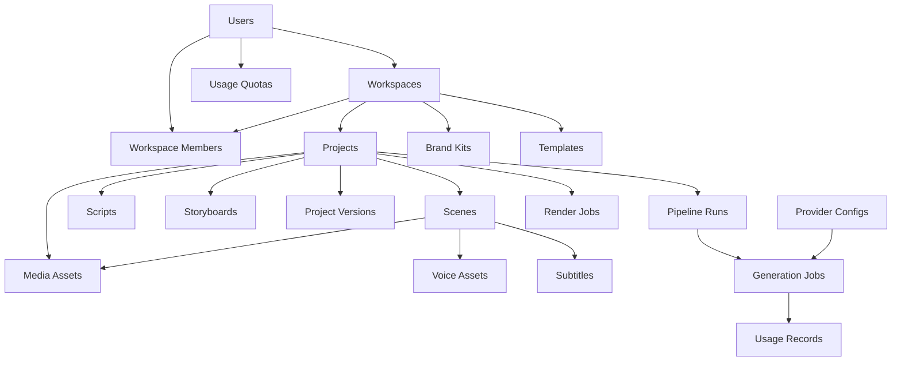

# AI Video Studio
## Database Design Document (DDD) — Version 1.0

**Document status:** Initial database design  
**Version:** 1.0  
**Database:** MongoDB  
**ODM:** Mongoose  
**Backend:** Node.js + Express + TypeScript  
**Architecture:** Modular monolith  
**Tenancy model:** Multi-user, multi-workspace  
**Storage strategy:** Database for structured data; filesystem/object storage for media files

---

# 1. Introduction

This document defines the MongoDB database architecture for AI Video Studio.

The database will store all structured application information, including:

- User accounts and authentication.
- Workspaces and workspace membership.
- Video projects.
- Scripts and storyboards.
- Individual scenes.
- Timeline configurations.
- Media assets.
- Voiceovers and subtitles.
- AI provider configurations.
- AI generation jobs.
- Video rendering jobs.
- API usage and quotas.
- Templates and brand kits.
- Notifications.
- Scheduling and social media publishing.
- Subscriptions and billing.
- Audit logs.

The database must support the complete lifecycle of a video project, from initial creation to final export.

# 2. Database Design Principles

The following principles will guide the database implementation.

## 2.1 Multi-tenancy

Every user-owned resource must have appropriate ownership information.

Workspace-owned resources must include a `workspaceId`.

This ensures that users can manage multiple projects without accessing another user's information.

## 2.2 Separation of concerns

Each major feature should have its own collection.

For example:

- Projects are stored separately from scenes.
- Scenes are stored separately from media assets.
- Generation jobs are separate from rendering jobs.
- Provider configuration is separate from API usage.

## 2.3 Avoid large binary data in MongoDB

Do not store large video, image or audio files directly in ordinary MongoDB documents.

Store files in:

- Local filesystem during development.
- Cloud object storage in production.

MongoDB stores metadata and storage references.

## 2.4 Flexible schemas

Use Mongoose schemas with validation.

Use flexible nested structures for editor configurations and provider-specific metadata where appropriate.

## 2.5 Versioning

Scripts, storyboards and video projects must support version history and restoration.

## 2.6 Security

- Never store plaintext passwords.
- Never expose API keys.
- Enforce ownership checks.
- Validate every document update.
- Use appropriate indexes.
- Avoid storing unnecessary sensitive data.

# 3. Database Architecture Overview

The database is divided into the following functional domains.

| Domain | Collections |
|---|---|
| Authentication | users, sessions, verification_tokens, password_reset_tokens |
| Workspace | workspaces, workspace_members, invitations |
| Projects | projects, scenes, scripts, storyboards, project_versions |
| Media | media_assets, voice_assets, subtitles |
| AI processing | generation_jobs, pipeline_runs |
| Rendering | render_jobs |
| Providers | provider_configs, provider_credentials |
| Usage | usage_records, usage_quotas |
| Templates | templates, brand_kits |
| Scheduling | schedules, social_accounts, publishing_jobs |
| Billing | plans, subscriptions, transactions |
| Notifications | notifications |
| Administration | audit_logs |

# 4. Database Relationship Diagram



The diagram represents logical relationships. MongoDB will use document references rather than relational foreign keys.

# 5. Collection Design

## 5.1 Users

**Collection:** `users`

Stores registered user accounts.

### Fields

| Field | Type | Description |
|---|---|---|
| `_id` | ObjectId | User ID |
| `name` | String | Full name |
| `email` | String | Unique email |
| `passwordHash` | String | Hashed password |
| `avatar` | String | Profile image reference |
| `status` | String | Account status |
| `emailVerified` | Boolean | Email verification status |
| `defaultWorkspaceId` | ObjectId | Default workspace |
| `preferences` | Object | User preferences |
| `lastLoginAt` | Date | Last login |
| `createdAt` | Date | Creation date |
| `updatedAt` | Date | Last update |

### Example

```json
{
  "_id": "ObjectId",
  "name": "Example User",
  "email": "user@example.com",
  "passwordHash": "hashed-password",
  "avatar": null,
  "status": "active",
  "emailVerified": false,
  "defaultWorkspaceId": "ObjectId",
  "preferences": {
    "language": "en",
    "theme": "dark",
    "timezone": "Asia/Kolkata"
  }
}
```

### Indexes

- Unique index on `email`.
- Index on `status`.
- Index on `createdAt`.

Passwords must be hashed using a suitable password hashing algorithm such as Argon2id.

---

## 5.2 Sessions

**Collection:** `sessions`

Stores active authentication sessions if database-backed sessions are used.

| Field | Type | Description |
|---|---|---|
| `_id` | ObjectId | Session ID |
| `userId` | ObjectId | User reference |
| `tokenHash` | String | Hashed session token |
| `expiresAt` | Date | Expiration |
| `revokedAt` | Date | Revocation time |
| `createdAt` | Date | Creation time |

Indexes:

- `userId`.
- TTL index on `expiresAt`.

Do not store raw session tokens.

## 5.3 Verification Tokens

**Collection:** `verification_tokens`

Stores email verification tokens.

Fields:

- `userId`
- `tokenHash`
- `expiresAt`
- `usedAt`
- `createdAt`

Use TTL cleanup for expired records.

## 5.4 Password Reset Tokens

**Collection:** `password_reset_tokens`

Fields:

- `userId`
- `tokenHash`
- `expiresAt`
- `usedAt`
- `createdAt`

Tokens must be single-use and time-limited.

---

# 6. Workspace Collections

## 6.1 Workspaces

**Collection:** `workspaces`

A workspace is the main ownership boundary for projects and collaborative resources.

### Fields

| Field | Type | Description |
|---|---|---|
| `_id` | ObjectId | Workspace ID |
| `name` | String | Workspace name |
| `slug` | String | Workspace identifier |
| `ownerId` | ObjectId | Owner |
| `type` | String | Personal or team |
| `status` | String | Workspace status |
| `settings` | Object | Workspace settings |
| `createdAt` | Date | Creation date |
| `updatedAt` | Date | Last update |

Example:

```json
{
  "_id": "ObjectId",
  "name": "My Workspace",
  "slug": "my-workspace",
  "ownerId": "ObjectId",
  "type": "personal",
  "status": "active",
  "settings": {
    "defaultLanguage": "en",
    "defaultAspectRatio": "16:9",
    "defaultResolution": "1080p"
  }
}
```

Indexes:

- Unique index on `slug`.
- Index on `ownerId`.

## 6.2 Workspace Members

**Collection:** `workspace_members`

Supports collaboration.

Fields:

- `workspaceId`
- `userId`
- `role`
- `status`
- `joinedAt`
- `createdAt`

Roles:

- `owner`
- `admin`
- `editor`
- `viewer`

Create a compound unique index on:

`{ workspaceId: 1, userId: 1 }`

## 6.3 Invitations

**Collection:** `invitations`

Fields:

- `workspaceId`
- `invitedBy`
- `email`
- `role`
- `tokenHash`
- `status`
- `expiresAt`
- `acceptedAt`
- `createdAt`

Invitation tokens must be securely hashed.

---

# 7. Project Collections

## 7.1 Projects

**Collection:** `projects`

This is the main collection for video projects.

### Fields

| Field | Type | Description |
|---|---|---|
| `_id` | ObjectId | Project ID |
| `workspaceId` | ObjectId | Workspace reference |
| `ownerId` | ObjectId | Project creator |
| `title` | String | Project title |
| `description` | String | Project description |
| `creationType` | String | Prompt, script, document, etc. |
| `status` | String | Project status |
| `settings` | Object | Video configuration |
| `scriptId` | ObjectId | Current script |
| `storyboardId` | ObjectId | Current storyboard |
| `brandKitId` | ObjectId | Selected brand kit |
| `currentVersionId` | ObjectId | Current version |
| `thumbnailAssetId` | ObjectId | Thumbnail reference |
| `finalVideoAssetId` | ObjectId | Final output |
| `createdAt` | Date | Creation date |
| `updatedAt` | Date | Last update |

### Example

```json
{
  "_id": "ObjectId",
  "workspaceId": "ObjectId",
  "ownerId": "ObjectId",
  "title": "Introduction to Artificial Intelligence",
  "description": "Educational explainer video",
  "creationType": "prompt",
  "status": "draft",
  "settings": {
    "duration": 120,
    "aspectRatio": "16:9",
    "resolution": "1080p",
    "fps": 30,
    "language": "en",
    "style": "animated-explainer",
    "subtitlesEnabled": true,
    "musicEnabled": true
  },
  "scriptId": null,
  "storyboardId": null,
  "brandKitId": null,
  "currentVersionId": null,
  "thumbnailAssetId": null,
  "finalVideoAssetId": null
}
```

### Creation types

- `prompt`
- `script`
- `document`
- `image`
- `audio`
- `video`
- `article`
- `template`

### Project statuses

- `draft`
- `processing`
- `ready`
- `rendering`
- `completed`
- `failed`
- `archived`

### Indexes

- `{ workspaceId: 1, updatedAt: -1 }`
- `{ ownerId: 1, createdAt: -1 }`
- `{ workspaceId: 1, status: 1 }`

---

# 8. Script Collection

**Collection:** `scripts`

Stores generated and manually edited scripts.

### Fields

- `_id`
- `workspaceId`
- `projectId`
- `version`
- `title`
- `language`
- `tone`
- `targetAudience`
- `sections`
- `totalWordCount`
- `estimatedDuration`
- `status`
- `providerMetadata`
- `createdBy`
- `createdAt`
- `updatedAt`

### Example

```json
{
  "_id": "ObjectId",
  "workspaceId": "ObjectId",
  "projectId": "ObjectId",
  "version": 1,
  "title": "Introduction to AI",
  "language": "en",
  "tone": "educational",
  "targetAudience": "college-students",
  "sections": [
    {
      "sectionId": "section_001",
      "heading": "What is AI?",
      "narration": "Artificial intelligence allows machines...",
      "estimatedDuration": 20,
      "order": 1
    }
  ],
  "totalWordCount": 250,
  "estimatedDuration": 120,
  "status": "approved",
  "providerMetadata": {
    "providerId": "gemini",
    "model": "configured-model"
  }
}
```

Indexes:

- `{ projectId: 1, version: -1 }`
- `{ workspaceId: 1, projectId: 1 }`

Script versions should be immutable once approved. Editing should create a new version or an explicitly managed draft.

---

# 9. Storyboard Collection

**Collection:** `storyboards`

Stores the visual plan for a project.

Fields:

- `_id`
- `workspaceId`
- `projectId`
- `scriptId`
- `version`
- `title`
- `scenes`
- `totalDuration`
- `status`
- `providerMetadata`
- `createdAt`
- `updatedAt`

### Example

```json
{
  "_id": "ObjectId",
  "workspaceId": "ObjectId",
  "projectId": "ObjectId",
  "scriptId": "ObjectId",
  "version": 1,
  "title": "AI Introduction Storyboard",
  "scenes": [
    {
      "sceneId": "scene_001",
      "title": "Introduction",
      "description": "Digital network animation",
      "duration": 12,
      "order": 1,
      "visualType": "animation",
      "transition": "fade"
    }
  ],
  "totalDuration": 120,
  "status": "approved"
}
```

Indexes:

- `{ projectId: 1, version: -1 }`
- `{ workspaceId: 1, projectId: 1 }`

For larger projects, the authoritative scene records will be stored in the separate `scenes` collection. Storyboards should contain only the information needed to organize and review the scene plan.

---

# 10. Scenes Collection

**Collection:** `scenes`

Scenes are the central building blocks of the video editor.

Each scene must be independently editable and regeneratable.

### Fields

| Field | Type | Description |
|---|---|---|
| `_id` | ObjectId | Scene ID |
| `workspaceId` | ObjectId | Workspace |
| `projectId` | ObjectId | Project |
| `storyboardId` | ObjectId | Storyboard |
| `sceneNumber` | Number | Scene order |
| `title` | String | Scene title |
| `duration` | Number | Duration in seconds |
| `narration` | String | Narration text |
| `visualDescription` | String | Visual instructions |
| `visualAssetIds` | Array | Visual asset references |
| `voiceAssetId` | ObjectId | Voice reference |
| `subtitleId` | ObjectId | Subtitle reference |
| `motionGraphics` | Array | Graphics configuration |
| `timeline` | Object | Scene timeline |
| `transition` | Object | Transition settings |
| `status` | String | Scene status |
| `createdAt` | Date | Creation date |
| `updatedAt` | Date | Last update |

### Example

```json
{
  "_id": "ObjectId",
  "workspaceId": "ObjectId",
  "projectId": "ObjectId",
  "storyboardId": "ObjectId",
  "sceneNumber": 1,
  "title": "Introduction",
  "duration": 12,
  "narration": "Welcome to the world of AI.",
  "visualDescription": "A digital network with connected nodes.",
  "visualAssetIds": ["ObjectId"],
  "voiceAssetId": "ObjectId",
  "subtitleId": "ObjectId",
  "motionGraphics": [
    {
      "type": "animated-title",
      "properties": {
        "text": "Introduction to AI",
        "animation": "fade-in"
      }
    }
  ],
  "timeline": {
    "startTime": 0,
    "endTime": 12
  },
  "transition": {
    "type": "fade",
    "duration": 1
  },
  "status": "ready"
}
```

Indexes:

- `{ projectId: 1, sceneNumber: 1 }`
- `{ workspaceId: 1, projectId: 1 }`

Use a unique compound index on project and scene number if scene numbering is maintained as unique within a project. Update scene order carefully when reordering.

---

# 11. Project Versions

**Collection:** `project_versions`

Stores recoverable snapshots of project configuration.

Fields:

- `_id`
- `workspaceId`
- `projectId`
- `versionNumber`
- `snapshot`
- `changeDescription`
- `createdBy`
- `createdAt`

The snapshot should reference the relevant script, storyboard, scene and timeline versions.

Avoid copying large media binaries into version documents.

Indexes:

- `{ projectId: 1, versionNumber: -1 }`
- Unique compound index on `{ projectId: 1, versionNumber: 1 }`

---

# 12. Media Collections

## 12.1 Media Assets

**Collection:** `media_assets`

Stores metadata for all uploaded and generated media.

### Fields

- `_id`
- `workspaceId`
- `projectId`
- `sceneId`
- `uploadedBy`
- `name`
- `type`
- `mimeType`
- `size`
- `duration`
- `width`
- `height`
- `storageProvider`
- `storageKey`
- `source`
- `sourceUrl`
- `providerMetadata`
- `licenseMetadata`
- `status`
- `createdAt`
- `updatedAt`

### Asset types

- `image`
- `video`
- `audio`
- `document`
- `thumbnail`
- `other`

### Sources

- `upload`
- `ai-generated`
- `stock`
- `template`
- `imported`
- `remotion-generated`

### Example

```json
{
  "_id": "ObjectId",
  "workspaceId": "ObjectId",
  "projectId": "ObjectId",
  "sceneId": "ObjectId",
  "uploadedBy": "ObjectId",
  "name": "ai-background.png",
  "type": "image",
  "mimeType": "image/png",
  "size": 2048000,
  "width": 1920,
  "height": 1080,
  "storageProvider": "local",
  "storageKey": "projects/project-id/images/asset-id.png",
  "source": "ai-generated",
  "providerMetadata": {
    "providerId": "configured-image-provider",
    "model": "configured-model"
  },
  "licenseMetadata": {
    "commercialUse": "unverified",
    "attributionRequired": null
  },
  "status": "ready"
}
```

Indexes:

- `{ workspaceId: 1, createdAt: -1 }`
- `{ projectId: 1, sceneId: 1 }`
- `{ type: 1, createdAt: -1 }`

Storage keys must not be treated as public URLs.

## 12.2 Voice Assets

**Collection:** `voice_assets`

Stores generated or uploaded narration.

Fields:

- `_id`
- `workspaceId`
- `projectId`
- `sceneId`
- `scriptSectionId`
- `providerId`
- `model`
- `voiceId`
- `language`
- `text`
- `duration`
- `storageKey`
- `format`
- `sampleRate`
- `generationStatus`
- `createdAt`

Indexes:

- `{ projectId: 1, sceneId: 1 }`
- `{ workspaceId: 1, createdAt: -1 }`

## 12.3 Subtitles

**Collection:** `subtitles`

Stores subtitle tracks and caption data.

Fields:

- `_id`
- `workspaceId`
- `projectId`
- `sceneId`
- `language`
- `format`
- `cues`
- `storageKey`
- `status`
- `createdAt`
- `updatedAt`

Example:

```json
{
  "_id": "ObjectId",
  "workspaceId": "ObjectId",
  "projectId": "ObjectId",
  "sceneId": "ObjectId",
  "language": "en",
  "format": "structured",
  "cues": [
    {
      "start": 0,
      "end": 3.5,
      "text": "Welcome to the world of AI."
    }
  ],
  "status": "ready"
}
```

For very large subtitle tracks, store the full subtitle file in object storage and retain only metadata and a reference in MongoDB.

---

# 13. AI Processing Collections

## 13.1 Pipeline Runs

**Collection:** `pipeline_runs`

Represents one complete execution of a video-generation pipeline.

Fields:

- `_id`
- `workspaceId`
- `projectId`
- `requestedBy`
- `pipelineType`
- `status`
- `currentStage`
- `progress`
- `stageResults`
- `startedAt`
- `completedAt`
- `error`
- `createdAt`

Example:

```json
{
  "_id": "ObjectId",
  "workspaceId": "ObjectId",
  "projectId": "ObjectId",
  "requestedBy": "ObjectId",
  "pipelineType": "prompt-to-video",
  "status": "processing",
  "currentStage": "voice-generation",
  "progress": 55,
  "stageResults": [
    {
      "stage": "script-generation",
      "status": "completed"
    },
    {
      "stage": "storyboard-generation",
      "status": "completed"
    },
    {
      "stage": "voice-generation",
      "status": "processing"
    }
  ],
  "startedAt": "2026-11-02T10:00:00.000Z"
}
```

Indexes:

- `{ projectId: 1, createdAt: -1 }`
- `{ workspaceId: 1, status: 1 }`

## 13.2 Generation Jobs

**Collection:** `generation_jobs`

Represents an individual AI generation task.

Fields:

- `_id`
- `workspaceId`
- `projectId`
- `sceneId`
- `pipelineRunId`
- `requestedBy`
- `providerId`
- `model`
- `capability`
- `jobType`
- `status`
- `inputReference`
- `outputAssetIds`
- `externalJobId`
- `attempts`
- `maxAttempts`
- `error`
- `startedAt`
- `completedAt`
- `createdAt`

### Job types

- `content-understanding`
- `script-generation`
- `storyboard-generation`
- `image-generation`
- `video-generation`
- `voice-generation`
- `speech-to-text`
- `translation`
- `music-generation`
- `sound-effects`

### Status values

- `pending`
- `queued`
- `processing`
- `waiting-for-provider`
- `completed`
- `failed`
- `cancelled`

Indexes:

- `{ workspaceId: 1, status: 1, createdAt: -1 }`
- `{ projectId: 1, createdAt: -1 }`
- `{ externalJobId: 1 }`

Do not use MongoDB as the job queue itself. BullMQ owns queue execution and scheduling. MongoDB stores durable application-level job records.

---

# 14. Rendering Jobs

**Collection:** `render_jobs`

Stores video rendering requests.

Fields:

- `_id`
- `workspaceId`
- `projectId`
- `requestedBy`
- `projectVersionId`
- `renderType`
- `settings`
- `status`
- `progress`
- `workerId`
- `outputAssetId`
- `error`
- `startedAt`
- `completedAt`
- `createdAt`

### Render types

- `scene-preview`
- `full-preview`
- `final-render`
- `thumbnail`

### Example

```json
{
  "_id": "ObjectId",
  "workspaceId": "ObjectId",
  "projectId": "ObjectId",
  "requestedBy": "ObjectId",
  "renderType": "final-render",
  "settings": {
    "format": "mp4",
    "resolution": "1080p",
    "fps": 30,
    "codec": "h264"
  },
  "status": "queued",
  "progress": 0
}
```

Indexes:

- `{ workspaceId: 1, status: 1, createdAt: -1 }`
- `{ projectId: 1, createdAt: -1 }`

A render job should reference a stable project version so that edits made while rendering do not unexpectedly change the output.

---

# 15. AI Provider Collections

## 15.1 Provider Configurations

**Collection:** `provider_configs`

Stores provider settings and capabilities.

Fields:

- `_id`
- `providerId`
- `name`
- `category`
- `enabled`
- `priority`
- `capabilities`
- `supportedModels`
- `environment`
- `quotaSettings`
- `healthStatus`
- `lastVerifiedAt`
- `createdAt`
- `updatedAt`

Example:

```json
{
  "_id": "ObjectId",
  "providerId": "gemini",
  "name": "Gemini",
  "category": "llm",
  "enabled": true,
  "priority": 1,
  "capabilities": [
    "llm",
    "document-understanding",
    "translation"
  ],
  "environment": "development",
  "healthStatus": "unknown"
}
```

Provider IDs must be unique.

## 15.2 Provider Credentials

**Collection:** `provider_credentials`

Stores encrypted provider credentials if a database-backed credential store is needed.

Fields:

- `_id`
- `providerId`
- `environment`
- `credentialReference`
- `encryptedCredential`
- `keyVersion`
- `status`
- `lastRotatedAt`
- `createdAt`

Prefer a managed secrets service in production.

Never store plaintext API keys.

The encryption key must be stored separately from the encrypted credential data.

## 15.3 Usage Records

**Collection:** `usage_records`

Tracks external API consumption.

Fields:

- `_id`
- `userId`
- `workspaceId`
- `projectId`
- `sceneId`
- `generationJobId`
- `providerId`
- `model`
- `capability`
- `requestId`
- `usage`
- `estimatedCost`
- `currency`
- `status`
- `createdAt`

Example:

```json
{
  "_id": "ObjectId",
  "userId": "ObjectId",
  "workspaceId": "ObjectId",
  "projectId": "ObjectId",
  "providerId": "gemini",
  "model": "configured-model",
  "capability": "llm",
  "usage": {
    "inputTokens": 1000,
    "outputTokens": 500
  },
  "estimatedCost": 0,
  "currency": "USD",
  "status": "success"
}
```

An estimated cost of zero should only be recorded when the applicable usage is confirmed to be free.

Indexes:

- `{ workspaceId: 1, createdAt: -1 }`
- `{ providerId: 1, createdAt: -1 }`
- `{ userId: 1, createdAt: -1 }`
- `{ generationJobId: 1 }`

## 15.4 Usage Quotas

**Collection:** `usage_quotas`

Stores user or workspace usage limits.

Fields:

- `_id`
- `workspaceId`
- `userId`
- `period`
- `periodStart`
- `periodEnd`
- `limits`
- `usage`
- `status`
- `updatedAt`

Example:

```json
{
  "_id": "ObjectId",
  "workspaceId": "ObjectId",
  "period": "monthly",
  "periodStart": "2026-11-01T00:00:00.000Z",
  "periodEnd": "2026-12-01T00:00:00.000Z",
  "limits": {
    "scriptGenerations": 100,
    "voiceCharacters": 10000,
    "videoRenders": 10,
    "storageBytes": 1073741824
  },
  "usage": {
    "scriptGenerations": 0,
    "voiceCharacters": 0,
    "videoRenders": 0,
    "storageBytes": 0
  },
  "status": "active"
}
```

Quota values should be configurable by subscription and workspace.

For concurrent quota enforcement, use atomic updates or a dedicated usage-accounting strategy. Do not rely on reading and then separately incrementing counters without protection.

---

# 16. Templates and Brand Kits

## 16.1 Templates

**Collection:** `templates`

Stores reusable video templates.

Fields:

- `_id`
- `workspaceId`
- `createdBy`
- `name`
- `description`
- `category`
- `aspectRatio`
- `thumbnailAssetId`
- `templateConfiguration`
- `visibility`
- `isSystemTemplate`
- `status`
- `createdAt`
- `updatedAt`

Templates may be system-wide or workspace-specific.

## 16.2 Brand Kits

**Collection:** `brand_kits`

Stores branding configurations.

Fields:

- `_id`
- `workspaceId`
- `name`
- `logoAssetId`
- `colors`
- `fonts`
- `typography`
- `voicePreferences`
- `introConfiguration`
- `outroConfiguration`
- `createdAt`
- `updatedAt`

Example:

```json
{
  "_id": "ObjectId",
  "workspaceId": "ObjectId",
  "name": "Default Brand",
  "logoAssetId": "ObjectId",
  "colors": {
    "primary": "#2563EB",
    "secondary": "#111827",
    "background": "#FFFFFF"
  },
  "fonts": {
    "heading": "Inter",
    "body": "Inter"
  },
  "voicePreferences": {
    "providerId": "elevenlabs",
    "voiceId": "configured-voice"
  }
}
```

# 17. Scheduling and Social Media Collections

These collections prepare the platform for future publishing features.

## 17.1 Social Accounts

**Collection:** `social_accounts`

Stores connected social media account metadata.

Fields:

- `_id`
- `workspaceId`
- `platform`
- `accountName`
- `externalAccountId`
- `credentialReference`
- `status`
- `connectedAt`
- `updatedAt`

Never store social access tokens in plaintext.

Use secure credential storage.

## 17.2 Schedules

**Collection:** `schedules`

Fields:

- `_id`
- `workspaceId`
- `projectId`
- `socialAccountId`
- `scheduledAt`
- `timezone`
- `caption`
- `hashtags`
- `mediaAssetId`
- `status`
- `createdBy`
- `createdAt`
- `updatedAt`

## 17.3 Publishing Jobs

**Collection:** `publishing_jobs`

Fields:

- `_id`
- `workspaceId`
- `scheduleId`
- `socialAccountId`
- `platform`
- `status`
- `externalPostId`
- `attempts`
- `error`
- `publishedAt`
- `createdAt`

Social platform integrations must follow each platform's API access and publishing requirements.

# 18. Subscription and Billing Collections

## 18.1 Plans

**Collection:** `plans`

Stores subscription plan definitions.

Fields:

- `_id`
- `name`
- `description`
- `price`
- `currency`
- `billingInterval`
- `limits`
- `features`
- `isActive`
- `createdAt`
- `updatedAt`

## 18.2 Subscriptions

**Collection:** `subscriptions`

Fields:

- `_id`
- `workspaceId`
- `planId`
- `provider`
- `externalSubscriptionId`
- `status`
- `currentPeriodStart`
- `currentPeriodEnd`
- `cancelAtPeriodEnd`
- `createdAt`
- `updatedAt`

## 18.3 Transactions

**Collection:** `transactions`

Fields:

- `_id`
- `workspaceId`
- `subscriptionId`
- `externalTransactionId`
- `amount`
- `currency`
- `status`
- `paymentProvider`
- `createdAt`

Never store full payment card numbers or CVV values.

Payment-provider integrations should use their approved tokenization and checkout mechanisms.

# 19. Notifications

**Collection:** `notifications`

Stores user notifications.

Fields:

- `_id`
- `userId`
- `workspaceId`
- `type`
- `title`
- `message`
- `referenceType`
- `referenceId`
- `readAt`
- `createdAt`

Notification types include:

- `generation-completed`
- `generation-failed`
- `render-completed`
- `render-failed`
- `invitation`
- `publishing-completed`
- `billing`
- `system`

Indexes:

- `{ userId: 1, createdAt: -1 }`
- `{ userId: 1, readAt: 1 }`

# 20. Audit Logs

**Collection:** `audit_logs`

Records important application activity.

Fields:

- `_id`
- `workspaceId`
- `userId`
- `action`
- `resourceType`
- `resourceId`
- `metadata`
- `ipAddress`
- `createdAt`

Examples:

- User login.
- Workspace creation.
- Member invitation.
- Project deletion.
- API credential update.
- Provider configuration change.
- Subscription change.

Avoid recording passwords, API keys, session tokens or sensitive document contents.

Audit logs should be append-only from the application perspective.

---

# 21. Complete Collection Summary

| No. | Collection | Priority |
|---:|---|---|
| 1 | users | MVP |
| 2 | sessions | MVP |
| 3 | verification_tokens | MVP |
| 4 | password_reset_tokens | MVP |
| 5 | workspaces | MVP |
| 6 | workspace_members | MVP |
| 7 | invitations | Later |
| 8 | projects | MVP |
| 9 | scripts | MVP |
| 10 | storyboards | MVP |
| 11 | scenes | MVP |
| 12 | project_versions | MVP |
| 13 | media_assets | MVP |
| 14 | voice_assets | MVP |
| 15 | subtitles | MVP |
| 16 | pipeline_runs | MVP |
| 17 | generation_jobs | MVP |
| 18 | render_jobs | MVP |
| 19 | provider_configs | MVP |
| 20 | provider_credentials | MVP |
| 21 | usage_records | MVP |
| 22 | usage_quotas | MVP |
| 23 | templates | MVP |
| 24 | brand_kits | Later |
| 25 | social_accounts | Later |
| 26 | schedules | Later |
| 27 | publishing_jobs | Later |
| 28 | plans | Later |
| 29 | subscriptions | Later |
| 30 | transactions | Later |
| 31 | notifications | MVP |
| 32 | audit_logs | MVP |

# 22. Indexing Strategy

Indexes are important for performance.

## 22.1 Required indexes

| Collection | Index |
|---|---|
| users | Unique email |
| sessions | userId, TTL expiresAt |
| workspaces | ownerId, unique slug |
| workspace_members | Unique workspaceId + userId |
| projects | workspaceId + updatedAt |
| scripts | projectId + version |
| storyboards | projectId + version |
| scenes | projectId + sceneNumber |
| media_assets | workspaceId + createdAt |
| generation_jobs | workspaceId + status |
| render_jobs | workspaceId + status |
| provider_configs | Unique providerId |
| usage_records | workspaceId + createdAt |
| notifications | userId + createdAt |
| schedules | scheduledAt + status |

Create indexes through controlled database migrations or versioned deployment scripts.

Do not add indexes indiscriminately. Review query patterns and actual database performance.

# 23. Data Ownership and Authorization

Every protected database operation must verify ownership.

Example:

```typescript
const project = await Project.findOne({
  _id: projectId,
  workspaceId: authorizedWorkspaceId
});
```

Never fetch a project using only its ID and assume the requester has permission.

The authorization layer must check:

1. Authenticated user.
2. Workspace membership.
3. Workspace role.
4. Resource ownership and access.
5. Requested operation permissions.

Use centralized repository and service-layer authorization checks.

# 24. MongoDB Schema Design Strategy

Use Mongoose for application-level schemas.

Recommended project structure:

```text
backend/
  src/
    database/
      connection.ts

      models/
        User.model.ts
        Session.model.ts
        Workspace.model.ts
        WorkspaceMember.model.ts

        Project.model.ts
        Script.model.ts
        Storyboard.model.ts
        Scene.model.ts
        ProjectVersion.model.ts

        MediaAsset.model.ts
        VoiceAsset.model.ts
        Subtitle.model.ts

        PipelineRun.model.ts
        GenerationJob.model.ts
        RenderJob.model.ts

        ProviderConfig.model.ts
        ProviderCredential.model.ts
        UsageRecord.model.ts
        UsageQuota.model.ts

        Template.model.ts
        BrandKit.model.ts

        Notification.model.ts
        AuditLog.model.ts

      migrations/
      indexes/
      seeds/
```

Each model should have:

- TypeScript interface.
- Mongoose schema.
- Validation.
- Index definitions.
- Timestamps where appropriate.

Avoid putting business logic directly inside Mongoose models.

# 25. Data Consistency and Transactions

MongoDB supports multi-document transactions when deployed as a replica set or compatible sharded cluster.

Use transactions when multiple related records must change atomically.

Examples:

- Workspace creation and initial owner membership.
- Project creation and associated initial records.
- Subscription state changes.
- Critical usage accounting operations.

For long-running AI generation workflows, do not attempt to hold database transactions open while calling external APIs.

Instead:

1. Save the job record.
2. Queue the task.
3. Execute the external API request.
4. Save the result.
5. Update job status.

Use idempotency keys and recovery logic to handle duplicate job execution.

# 26. File Storage and Database Responsibilities

MongoDB stores metadata, not the actual large media content.

Example:

```json
{
  "_id": "ObjectId",
  "name": "final-video.mp4",
  "storageProvider": "local",
  "storageKey": "projects/project-id/exports/final-video.mp4",
  "mimeType": "video/mp4",
  "size": 25000000,
  "duration": 120
}
```

The storage service resolves `storageKey` into a local path or secure signed URL.

Do not expose internal filesystem paths to the browser.

# 27. Database Environment Configuration

Development environment:

```env
MONGODB_URI=mongodb://127.0.0.1:27017/ai_video_studio
```

Production should use a secured database connection string supplied through a secrets manager.

Environment separation:

- Development.
- Testing.
- Staging.
- Production.

Never share production credentials with local development.

# 28. Backup and Recovery

The production database must have:

- Scheduled backups.
- Retention policies.
- Restore testing.
- Access restrictions.
- Monitoring.
- Recovery procedures.

Important user-generated content must also be backed up in the relevant object storage system.

Database backups alone are insufficient if media files are stored separately.

# 29. Data Retention and Deletion

The platform must support:

- User account deletion.
- Workspace deletion.
- Project deletion.
- Media asset deletion.
- Expired session cleanup.
- Expired token cleanup.
- Temporary asset cleanup.
- Job history retention.
- Audit log retention.

When deleting a project, identify all related assets and records.

Use a controlled deletion workflow rather than immediately deleting files referenced by active jobs or project versions.

Use TTL indexes only for records with a clearly defined expiration policy.

# 30. MVP Database Implementation Order

Do not implement all 32 collections at once.

Implement them in the following order.

## Phase 1 — Core foundation

1. users
2. sessions
3. workspaces
4. workspace_members
5. projects

## Phase 2 — Content creation

6. scripts
7. storyboards
8. scenes
9. project_versions

## Phase 3 — Media and generation

10. media_assets
11. voice_assets
12. subtitles
13. pipeline_runs
14. generation_jobs
15. render_jobs

## Phase 4 — AI provider infrastructure

16. provider_configs
17. provider_credentials
18. usage_records
19. usage_quotas

## Phase 5 — Product features

20. templates
21. brand_kits
22. notifications
23. audit_logs

## Phase 6 — SaaS expansion

24. invitations
25. social_accounts
26. schedules
27. publishing_jobs
28. plans
29. subscriptions
30. transactions

# 31. Database Acceptance Criteria

The database design is ready for implementation when:

- Users can register and authenticate.
- Workspaces can be created.
- Users can access only authorized workspaces.
- Projects can be created and retrieved.
- Scripts and storyboards can be saved.
- Scenes can be independently updated.
- Project versions can be restored.
- Media metadata can be stored.
- Media files can be resolved through the storage layer.
- Generation jobs can be tracked.
- Rendering jobs can be tracked.
- Provider usage can be recorded.
- Quotas can be enforced safely.
- Important queries have appropriate indexes.
- Database backups and deletion procedures are defined.

# 32. Final Database Decisions

1. MongoDB will be the primary application database.
2. Mongoose will provide schema management and validation.
3. A workspace will be the primary ownership boundary for collaborative resources.
4. Users will have personal workspaces by default.
5. Projects, scenes, scripts and storyboards will use separate collections.
6. Media files will be stored outside MongoDB.
7. AI jobs and rendering jobs will have separate collections.
8. BullMQ will manage background execution.
9. Provider usage and quotas will be tracked in MongoDB.
10. Versioning will be supported for important project content.
11. All resource access will enforce workspace authorization.
12. Subscription and social publishing collections will be introduced as later phases.

---

**Document:** Database Design Document  
**Version:** 1.0  
**Status:** Initial database architecture established  
**Next document:** Backend API Specification