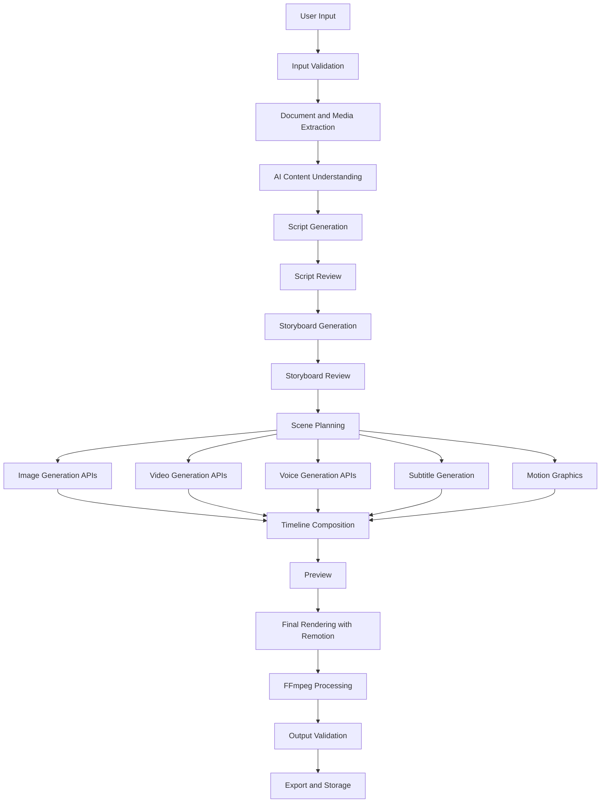

# AI Video Studio
## Video Generation Pipeline Specification — Version 1.1

**Document status:** Updated technical specification  
**Version:** 1.1  
**Architecture:** API-first  
**AI execution:** External hosted APIs  
**Video composition:** Remotion  
**Media processing:** FFmpeg  
**Backend:** Node.js + Express + TypeScript  
**Queue:** BullMQ + Redis-compatible infrastructure  
**Database:** MongoDB

---

# 1. Introduction

The Video Generation Pipeline defines how AI Video Studio transforms user-provided content into professional videos.

Users should be able to create videos using:

- Text prompts.
- Scripts.
- PDF documents.
- PowerPoint presentations.
- Images.
- Audio recordings.
- Existing videos.
- Articles and URLs.

The platform will use external AI APIs for content understanding, script generation, image generation, video generation, voice generation and other AI capabilities.

Remotion and FFmpeg will transform the generated content and assets into a final video.

## 1.1 Core principles

1. No locally hosted AI models.
2. No Ollama or mandatory GPU.
3. Use hosted AI APIs.
4. Prioritize free-tier APIs during development.
5. Support multiple providers for each capability.
6. Preserve editable scene-level data.
7. Support scene regeneration without regenerating the entire video.
8. Use asynchronous background processing.
9. Track API usage, quotas and costs.
10. Allow users to review and edit content before final rendering.

# 2. Complete Pipeline Overview

The pipeline consists of the following stages:

| Stage | Process |
|---|---|
| 1 | User input acquisition |
| 2 | Input validation |
| 3 | File and document extraction |
| 4 | Content understanding |
| 5 | Script generation |
| 6 | Script validation and editing |
| 7 | Storyboard generation |
| 8 | Storyboard approval |
| 9 | Scene planning |
| 10 | Visual asset generation |
| 11 | Voice generation |
| 12 | Subtitle generation |
| 13 | Motion graphics generation |
| 14 | Timeline composition |
| 15 | Preview generation |
| 16 | Final rendering |
| 17 | Output validation |
| 18 | Export and storage |

# 3. High-Level Pipeline Diagram



# 4. Stage 1 — User Input Acquisition

The user starts a new video project.

The platform should provide different creation methods.

## 4.1 Input methods

### A. Prompt-to-video

Example:

"Create a 2-minute animated explainer video about artificial intelligence for college students."

The user provides a prompt and selects video settings.

### B. Script-to-video

The user provides an existing script.

The platform analyzes the script and converts it into scenes.

### C. Document-to-video

Supported formats initially:

- PDF.
- PPT.
- PPTX.
- DOCX.
- TXT.

The system extracts the document content and uses it to create an appropriate video.

### D. Image-to-video

The user uploads images.

The platform can use them as source visuals, generate motion effects where supported, and organize them into scenes.

### E. Audio-to-video

The user uploads an audio recording.

The system transcribes it, identifies important sections and generates visual scenes synchronized with the audio.

### F. Video-to-video

The user uploads an existing video.

Possible operations:

- Summarization.
- Subtitle generation.
- Scene extraction.
- Reformatting.
- Adding narration.
- Creating short clips.

### G. Article-to-video

The user provides an article URL.

The backend retrieves accessible article content, extracts relevant text and creates a video from it.

Access restrictions, copyright and source permissions must be respected.

## 4.2 Input configuration

The user can select:

| Setting | Options |
|---|---|
| Video duration | 30 sec, 1 min, 2 min, 5 min, custom |
| Aspect ratio | 16:9, 9:16, 1:1, 4:5 |
| Resolution | 720p, 1080p, 4K where supported |
| Language | Multiple supported languages |
| Video style | Explainer, educational, cinematic, corporate, social |
| Visual style | Animation, AI footage, presenter, hybrid |
| Voice | AI voice, uploaded audio, no narration |
| Subtitles | On / Off |
| Music | On / Off |
| Brand kit | Select saved brand |

The platform should validate that requested settings are supported by the selected generation providers.

# 5. Stage 2 — Input Validation

Before processing, validate:

- File format.
- File size.
- File integrity.
- MIME type.
- Video and audio duration.
- Image dimensions.
- Document readability.
- URL accessibility.
- User permissions.
- Available usage quota.

Invalid inputs should return clear error messages.

Uploaded files must be securely stored and scanned according to the platform's security policy.

# 6. Stage 3 — Document and Media Extraction

This stage converts different input formats into structured content.

## 6.1 PDF extraction

Extract:

- Text.
- Headings.
- Paragraphs.
- Tables where possible.
- Page numbers.
- Image references.

For scanned PDFs, use an appropriate OCR service or hosted document-processing API.

## 6.2 PowerPoint extraction

Extract:

- Slide titles.
- Slide text.
- Images.
- Notes where available.
- Slide ordering.

## 6.3 Audio extraction

Use FFmpeg or an appropriate media-processing library to prepare audio for transcription.

## 6.4 Video extraction

Extract:

- Video metadata.
- Duration.
- Resolution.
- Audio track.
- Keyframes or representative frames.
- Scene boundaries where supported.

## 6.5 URL extraction

Retrieve accessible page content and extract:

- Title.
- Main text.
- Headings.
- Relevant images.
- Source URL.

All extracted information should be stored as structured intermediate data.

# 7. Stage 4 — AI Content Understanding

**Initial provider:** Gemini API.

The extracted content is passed to an LLM provider through the API Provider Manager.

The AI should identify:

- Main topic.
- Key concepts.
- Important facts.
- Supporting information.
- Target audience.
- Content difficulty.
- Narrative structure.
- Important visual opportunities.
- Possible scenes.
- Important source references.

Example structured response:

```json
{
  "topic": "Introduction to Artificial Intelligence",
  "audience": "College Students",
  "keyConcepts": [
    "Machine Learning",
    "Neural Networks",
    "Deep Learning"
  ],
  "tone": "Educational",
  "suggestedDuration": 120,
  "visualApproach": "Animated Explainer"
}
```

The output must follow a validated JSON schema.

The system should preserve source references for document-based videos so users can verify important information.

# 8. Stage 5 — Script Generation

**Initial provider:** Gemini API.

The AI generates a structured narration script based on the user's input and video configuration.

## 8.1 Script requirements

The script should include:

- Introduction.
- Main content.
- Supporting explanations.
- Examples.
- Transitions.
- Conclusion.
- Call to action where appropriate.

## 8.2 Script structure

Each script section should contain:

- Section ID.
- Heading.
- Narration.
- Estimated duration.
- Key message.
- Visual suggestion.

Example:

```json
{
  "title": "Introduction to AI",
  "sections": [
    {
      "id": "section_01",
      "heading": "What is AI?",
      "narration": "Artificial intelligence allows machines...",
      "estimatedDuration": 20,
      "keyMessage": "Understanding AI"
    }
  ]
}
```

## 8.3 Script editing

Before proceeding, the user should be able to:

- Edit narration.
- Rewrite sections.
- Expand or shorten content.
- Change tone.
- Change language.
- Regenerate the complete script.
- Regenerate individual sections.

Script changes should invalidate only the dependent downstream stages.

# 9. Stage 6 — Script Validation

Validate:

- Script length.
- Estimated narration duration.
- Repeated content.
- Missing sections.
- Language consistency.
- User requirements.
- Source alignment for document-based videos.

The user must be able to approve or modify the script before storyboard generation.

# 10. Stage 7 — Storyboard Generation

**Initial provider:** Gemini API.

The approved script is converted into a storyboard.

Each scene describes what the viewer should see and hear.

## 10.1 Storyboard fields

Each scene should include:

- Scene ID.
- Scene title.
- Narration.
- Estimated duration.
- Visual description.
- Visual type.
- Camera movement where relevant.
- Text overlays.
- Animation instructions.
- Transition.
- Background music requirements.
- Asset generation requirements.

Example:

```json
{
  "sceneId": "scene_001",
  "title": "Introduction",
  "duration": 12,
  "narration": "Welcome to the world of AI.",
  "visual": {
    "type": "animated",
    "description": "Digital network with connected nodes",
    "cameraMovement": "slow zoom"
  },
  "textOverlays": [
    {
      "text": "Introduction to AI",
      "position": "center"
    }
  ],
  "transition": "fade"
}
```

## 10.2 Storyboard editing

Users can:

- Change scene order.
- Add scenes.
- Remove scenes.
- Edit narration.
- Change visual descriptions.
- Adjust duration.
- Change visual style.
- Regenerate individual scenes.

The storyboard must be approved before expensive media generation begins.

# 11. Stage 8 — Scene Planning

The approved storyboard is converted into an executable scene plan.

The scene planner determines:

- Required images.
- Required AI video clips.
- Required voice segments.
- Text and graphics.
- Animation components.
- Background music.
- Transitions.
- Asset dependencies.

Each asset receives a unique ID and generation status.

Example:

```json
{
  "sceneId": "scene_001",
  "assets": [
    {
      "assetId": "asset_001",
      "type": "image",
      "providerCategory": "image",
      "status": "pending"
    },
    {
      "assetId": "asset_002",
      "type": "voice",
      "providerCategory": "voice",
      "status": "pending"
    }
  ]
}
```

This stage creates the dependency graph for background jobs.

# 12. Stage 9 — Visual Asset Generation

Visuals can come from multiple sources.

## 12.1 AI image generation

Possible uses:

- Backgrounds.
- Illustrations.
- Characters.
- Educational diagrams.
- Product visuals.
- Scene-specific artwork.

The application sends requests through image provider adapters.

## 12.2 AI video generation

Possible uses:

- Cinematic footage.
- Short scene clips.
- Product demonstrations.
- Animated environments.
- Presenter-style footage where supported.

The system should support asynchronous provider APIs:

1. Submit generation request.
2. Save provider job ID.
3. Poll or receive webhook updates.
4. Retrieve the completed asset.
5. Validate the returned file.
6. Store the asset.
7. Update scene status.

Do not assume every video provider offers a free tier or supports the same duration, resolution or features.

## 12.3 Existing media

Users may also choose assets from:

- Their media library.
- Uploaded files.
- Approved stock-media providers.
- Existing project assets.

## 12.4 Asset validation

Validate:

- File format.
- Duration where applicable.
- Resolution.
- Aspect ratio.
- File accessibility.
- Content suitability.
- Provider generation status.

# 13. Stage 10 — Voice Generation

**Initial provider:** ElevenLabs API.

Voice generation converts approved narration into audio.

## 13.1 Capabilities

- Text-to-speech.
- Multiple voices.
- Voice selection.
- Language selection.
- Voice style and delivery settings where supported.
- Voice generation per scene.
- Audio regeneration.
- Voice preview.

## 13.2 Voice workflow

1. Retrieve approved narration.
2. Select configured voice provider.
3. Submit generation request.
4. Retrieve generated audio.
5. Store audio asset.
6. Extract audio duration.
7. Associate audio with the scene.

Voice generation should be performed per scene or logical narration segment to support independent editing.

The platform must enforce provider licensing and usage restrictions.

# 14. Stage 11 — Subtitle Generation

Subtitles may be generated from:

- Approved script text.
- Generated voice transcription.
- User-uploaded audio transcription.

The system should support:

- SRT.
- VTT.
- Structured subtitle data.

Example:

```json
{
  "sceneId": "scene_001",
  "subtitles": [
    {
      "start": 0.0,
      "end": 3.5,
      "text": "Welcome to the world of AI."
    }
  ]
}
```

Subtitle generation must support timing correction and manual editing.

# 15. Stage 12 — Motion Graphics Generation

Motion graphics will be created using reusable React and Remotion components.

AI can generate structured instructions for motion graphics, but actual rendering is performed by Remotion.

## 15.1 Supported motion graphics

- Kinetic typography.
- Animated titles.
- Lower thirds.
- Animated shapes.
- Charts.
- Diagrams.
- Timelines.
- Process flows.
- Infographics.
- Number counters.
- Logo animations.
- Callouts.
- Highlight effects.
- Scene transitions.

## 15.2 Component architecture

Create reusable components:

```text
video-engine/
  components/
    typography/
    charts/
    diagrams/
    transitions/
    backgrounds/
    lower-thirds/
    icons/
    shapes/
    infographics/
    animations/
```

Each component should accept validated properties.

AI-generated motion instructions must be mapped to approved component types. Do not execute arbitrary AI-generated JavaScript or code.

# 16. Stage 13 — Timeline Composition

The timeline composition stage combines all generated assets into a structured video project.

## 16.1 Timeline tracks

The editor should support:

1. Video track.
2. Image track.
3. Voice track.
4. Music track.
5. Sound effects track.
6. Text track.
7. Motion graphics track.
8. Subtitle track.

## 16.2 Scene composition

Each scene contains:

- Visual assets.
- Narration.
- Audio.
- Text overlays.
- Motion graphics.
- Animation settings.
- Start time.
- End time.
- Transition configuration.

## 16.3 Timeline requirements

- Drag and drop.
- Trim and resize.
- Split and merge.
- Reorder scenes.
- Adjust duration.
- Move elements.
- Layer management.
- Audio synchronization.
- Preview playback.
- Undo and redo.
- Autosave.

The timeline data must remain editable independently of the final rendered video.

# 17. Stage 14 — Preview Generation

Before final rendering, the system should generate a preview.

Preview options:

- Single-scene preview.
- Selected-scene preview.
- Full video preview.
- Low-resolution draft preview.

Users should be able to:

- Review narration.
- Check transitions.
- Check text alignment.
- Review subtitles.
- Check audio synchronization.
- Make changes before final rendering.

The preview process should reuse generated assets wherever possible.

# 18. Stage 15 — Final Video Rendering

**Technology:** Remotion.

Once the user approves the project, a rendering job is created.

## 18.1 Rendering workflow

1. Retrieve approved project data.
2. Load scene configuration.
3. Retrieve media assets.
4. Validate asset availability.
5. Prepare the Remotion composition.
6. Calculate scene timings.
7. Compose all tracks.
8. Render video frames.
9. Synchronize audio.
10. Generate the video file.
11. Pass the result to FFmpeg if further processing is needed.

## 18.2 Export settings

| Setting | Supported options |
|---|---|
| Aspect ratio | 16:9, 9:16, 1:1, 4:5 |
| Resolution | 720p, 1080p, 4K subject to worker capacity |
| Format | MP4 initially |
| Codec | H.264 initially |
| Frame rate | 24, 25, 30, 60 FPS where appropriate |
| Audio | AAC |

Rendering quality and available export options must be validated against the actual worker and provider capabilities.

# 19. Stage 16 — FFmpeg Processing

FFmpeg handles media-processing operations after or before Remotion rendering where required.

Possible operations:

- Video encoding.
- Audio normalization.
- Audio mixing.
- Resizing.
- Cropping.
- Frame-rate conversion.
- Audio extraction.
- Subtitle embedding.
- Thumbnail generation.
- Format conversion.

Keep the FFmpeg processing pipeline configurable.

# 20. Stage 17 — Output Validation

Before the video is marked complete, validate:

- File exists.
- File is readable.
- Duration is correct within acceptable tolerance.
- Resolution is correct.
- Audio is present when expected.
- Video is not corrupted.
- Subtitle output is correct when requested.
- File size is within limits.
- Export format matches user selection.

If validation fails, record the failure and provide a retry option where possible.

# 21. Stage 18 — Export and Storage

After successful validation:

1. Save the final video.
2. Generate a thumbnail.
3. Save video metadata.
4. Associate the video with its project.
5. Update the job status.
6. Notify the user.
7. Provide a download or playback link.

Initial development uses local storage.

Production will use cloud object storage and secure access URLs.

# 22. Background Job Orchestration

Use BullMQ to manage long-running processing tasks.

## 22.1 Suggested queues

```text
input-processing
document-extraction
content-understanding
script-generation
storyboard-generation
scene-planning
image-generation
video-generation
voice-generation
subtitle-generation
motion-graphics
preview-rendering
final-rendering
output-validation
video-export
```

## 22.2 Job dependency management

Some stages can run in parallel.

For example, after scene planning:

- Image generation can run independently.
- Voice generation can run independently.
- Subtitle generation can run after narration is finalized.
- Motion graphics can be prepared independently.

Final composition must wait until all required assets are ready.

Use BullMQ dependencies or an explicit orchestration service to coordinate these jobs.

## 22.3 Job status

```text
PENDING
QUEUED
PROCESSING
WAITING_FOR_PROVIDER
COMPLETED
FAILED
CANCELLED
```

Track stage-level progress rather than showing only one generic percentage.

# 23. Scene-Level Regeneration

This is a critical feature of AI Video Studio.

Users should not need to regenerate the entire video when they want to change one scene.

Examples:

- Change a scene's image.
- Regenerate its AI video clip.
- Rewrite its narration.
- Change its voice.
- Modify text animation.
- Change transition.
- Adjust duration.

## 23.1 Dependency invalidation

When a scene changes, only dependent assets should be regenerated.

| Change | Regenerate |
|---|---|
| Visual description | Relevant visual assets |
| Narration text | Voice and dependent subtitles |
| Voice selection | Voice asset |
| Subtitle text | Subtitle asset |
| Motion graphics | Relevant graphics |
| Scene duration | Timeline and affected render |
| Scene order | Timeline and final composition |
| Global background music | Audio mix and final render |

The system should preserve unaffected assets.

# 24. Project Versioning

Every significant edit should create a recoverable project version.

Store:

- Project configuration.
- Scene configuration.
- Script version.
- Storyboard version.
- Asset references.
- Timeline configuration.
- Export settings.

Support:

- Undo.
- Redo.
- Version history.
- Restore previous version.
- Compare versions.

Avoid duplicating large media files unnecessarily. Reuse immutable asset references when possible.

# 25. Caching and Reuse

To reduce API consumption:

- Cache successful provider outputs where appropriate.
- Reuse unchanged scene assets.
- Avoid regenerating identical narration.
- Reuse thumbnails.
- Reuse extracted document text.
- Reuse valid previews when dependencies have not changed.

Cache keys should include relevant input parameters, provider, model and generation settings.

Respect provider terms and user privacy when caching external API results.

# 26. Provider Integration and Fallback

All external AI calls must go through the API Provider Manager.

Example:

```text
Scene Planning
     |
     v
Provider Manager
     |
     v
Primary Image Provider
     |
     ├── Success -> Store Asset
     |
     └── Failure
            |
            v
       Eligible Fallback
            |
            ├── Success -> Store Asset
            └── Failure -> Job Failed
```

Fallback rules must consider:

- Capability compatibility.
- Output quality.
- Supported resolution.
- Duration limits.
- Usage quota.
- Commercial licensing.
- Cost.
- Data privacy.

Do not retry permanent failures such as invalid credentials without intervention.

# 27. API Usage and Cost Management

Every external provider request must create a usage record.

Track:

- User ID.
- Workspace ID.
- Project ID.
- Scene ID.
- Provider.
- Model.
- Capability.
- Request ID.
- Usage quantity.
- Estimated cost.
- Request status.
- Timestamp.

## 27.1 Initial free-tier strategy

During development:

- Use free-tier API access where available.
- Enforce configured request limits.
- Avoid unnecessary regeneration.
- Prefer inexpensive models for routine tasks.
- Use higher-quality models only when required.
- Track remaining quota where provider APIs expose it.

Free-tier availability and limits must be verified regularly.

## 27.2 Production strategy

Before commercial deployment:

- Review commercial-use licences.
- Establish paid provider accounts where required.
- Define user subscription limits.
- Set monthly API budgets.
- Implement overage controls.
- Add provider-specific usage alerts.

# 28. Error Handling and Recovery

Possible errors:

- API rate limits.
- API authentication failures.
- Network timeout.
- Invalid JSON output.
- Provider generation failure.
- Missing assets.
- Unsupported file format.
- Worker crash.
- Rendering failure.
- Storage failure.

Recovery strategy:

1. Record the error.
2. Identify the failed stage.
3. Determine whether retry is safe.
4. Retry transient failures with exponential backoff.
5. Use fallback providers when suitable.
6. Preserve completed stages.
7. Update the user with clear status.
8. Allow manual retry when appropriate.

Use idempotency protection to prevent duplicate generation and unintended API charges.

# 29. Security and Content Protection

- Store provider credentials only on the backend.
- Validate every uploaded file.
- Restrict file sizes and types.
- Use secure media URLs.
- Enforce user and workspace ownership.
- Prevent unauthorized access to generated assets.
- Avoid executing arbitrary generated code.
- Protect against malicious URLs and SSRF.
- Avoid exposing provider error details or secrets.
- Respect copyright and content ownership.
- Disclose external provider processing where appropriate.

# 30. Proposed Pipeline Database Entities

The pipeline will use the following MongoDB collections:

| Collection | Responsibility |
|---|---|
| projects | Video project metadata |
| scripts | Script content and versions |
| storyboards | Storyboard data |
| scenes | Scene configurations |
| media_assets | Images, videos and other assets |
| voice_assets | Generated narration |
| subtitles | Subtitle data |
| generation_jobs | AI generation jobs |
| render_jobs | Rendering jobs |
| pipeline_runs | Overall pipeline execution |
| usage_records | API usage and cost records |
| project_versions | Project history |

Detailed schemas, relationships and indexes will be defined in the Database Design Document.

# 31. Pipeline Acceptance Criteria

The pipeline will be considered ready for MVP when:

1. Users can create a project using a text prompt.
2. Users can upload at least one supported document format.
3. The application can extract document content.
4. Gemini can generate a structured script.
5. Users can edit and approve the script.
6. The application can generate a storyboard.
7. Users can approve and edit scenes.
8. The application can generate or import visual assets.
9. Voice generation can work through a provider adapter.
10. Subtitles can be generated and edited.
11. Remotion can compose a video from structured scene data.
12. FFmpeg can process the resulting video.
13. Users can preview and export the final video.
14. Background jobs report progress.
15. Failed jobs can be retried.
16. Individual scenes can be regenerated.
17. API usage is recorded.
18. API keys remain secure.
19. Projects and generated assets are saved.
20. The application works without installing local AI models.

# 32. Recommended MVP Pipeline

To avoid building every feature simultaneously, the first working pipeline should be:

```text
User enters prompt
       |
       v
Gemini generates script
       |
       v
User edits and approves script
       |
       v
Gemini generates storyboard
       |
       v
User approves storyboard
       |
       v
Generate scene visuals
       |
       v
Generate voice using configured API
       |
       v
Generate subtitles
       |
       v
Compose video with Remotion
       |
       v
Process with FFmpeg
       |
       v
Final MP4
```

Start with a small number of scenes and one supported export format. Expand to document ingestion, AI video footage, advanced motion graphics, multiple aspect ratios and professional timeline editing after the first complete workflow works reliably.

# 33. Final Technical Decision

AI Video Studio will use a modular, API-first video generation pipeline.

External providers will handle AI capabilities. The backend will coordinate the generation process through provider adapters and background workers. Remotion will compose the final video, while FFmpeg will perform media processing.

The pipeline will prioritize:

- Free-tier access during development.
- Provider independence.
- Secure API integration.
- Scene-level editing.
- Reusable generated assets.
- Controlled API consumption.
- Professional video output.
- Commercial readiness.

**Document:** Video Generation Pipeline Specification  
**Version:** 1.1  
**Status:** Updated architecture baseline  
**Next document:** API Provider Integration Specification