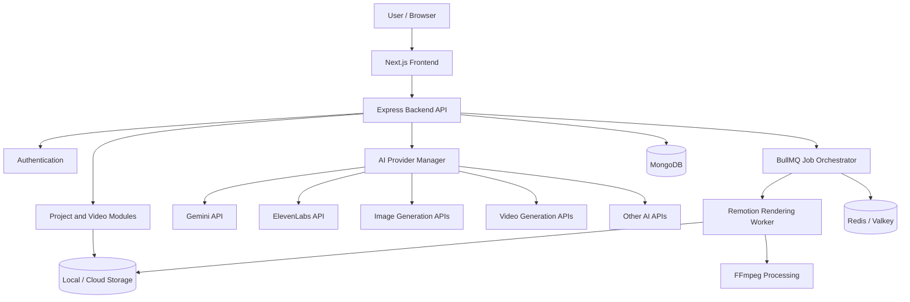
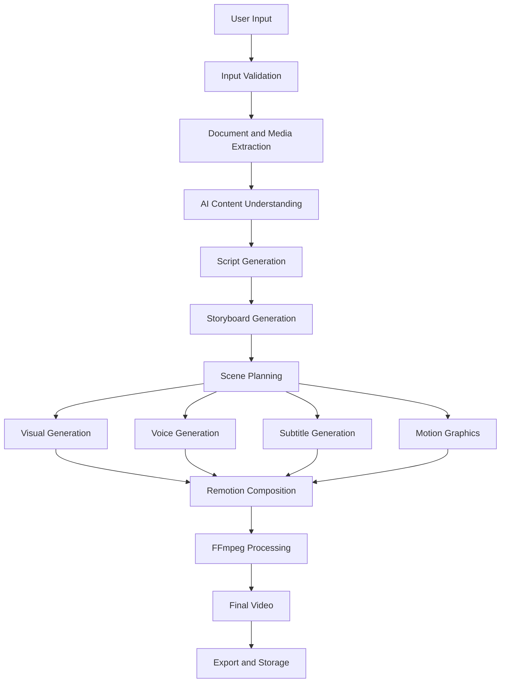

# AI Video Studio
## System Architecture Document (SAD) — Version 1.1

**Document status:** Architecture baseline  
**Version:** 1.1  
**Architecture approach:** API-first, provider-independent, cloud-ready  
**Initial development environment:** Windows 11  
**Product type:** Commercial AI Video SaaS

---

# 1. Executive Summary

AI Video Studio is a web-based SaaS platform that enables users to create professional videos using AI.

Users can provide prompts, scripts, PDFs, PowerPoint presentations, images, audio, videos and URLs. The platform processes these inputs and generates scripts, storyboards, voiceovers, visuals, motion graphics and final videos.

The system will use external AI provider APIs instead of running AI models locally.

The architecture will use a modular backend, provider abstraction, asynchronous processing, a professional video composition engine and scalable storage.

### Core architectural decisions

- No Ollama or locally hosted AI models.
- No mandatory local GPU or AI inference.
- Use external AI APIs, initially prioritizing free-tier access.
- Gemini API for text intelligence and document understanding.
- ElevenLabs API for voice generation where its free-tier terms permit.
- Other suitable providers for image, video, audio and translation capabilities.
- Remotion and FFmpeg for video composition and rendering.
- Next.js, React, Node.js, Express and MongoDB as the primary application stack.
- Local development first, cloud deployment later.
- Provider-independent architecture to avoid vendor lock-in.

# 2. Architecture Goals

The architecture must support:

1. Multiple video creation workflows.
2. Prompt-to-video and document-to-video generation.
3. AI-generated scripts and storyboards.
4. Scene-level editing and regeneration.
5. Professional motion graphics and animation.
6. Multiple voice and visual providers.
7. Background processing for long-running generation jobs.
8. Preview and high-quality video rendering.
9. Export in multiple formats and aspect ratios.
10. User workspaces, projects and brand kits.
11. Future social media scheduling and publishing.
12. Usage tracking, subscription plans and billing.
13. Multi-tenant SaaS deployment.
14. Provider replacement without rewriting business logic.

# 3. High-Level Architecture

The application is divided into six major layers.

## 3.1 Presentation Layer

**Technology:** Next.js, React, TypeScript, Tailwind CSS, shadcn/ui.

Responsibilities:

- Authentication and user onboarding.
- Dashboard and project management.
- Video creation interface.
- Script and storyboard editor.
- Professional video editor.
- Timeline and scene management.
- Media library.
- Brand kit management.
- Content calendar.
- Analytics and account settings.

The frontend communicates with the backend through authenticated REST APIs and real-time events.

## 3.2 Application Layer

**Technology:** Node.js, Express.js, TypeScript.

The backend is initially designed as a modular monolith.

Major modules:

- Authentication Module
- User Module
- Workspace Module
- Project Module
- Video Creation Module
- Script Module
- Storyboard Module
- Media Module
- Video Editor Module
- Rendering Module
- AI Provider Module
- Voice Module
- Brand Kit Module
- Template Module
- Scheduling Module
- Analytics Module
- Billing and Usage Module
- Notification Module
- Admin Module

Each module should have clearly defined responsibilities and interfaces.

## 3.3 AI Provider Layer

**Architecture:** External API integrations.

No AI model needs to be installed or executed locally.

The application communicates with external providers through a centralized API Provider Manager.

Initial provider choices:

| Capability | Initial provider strategy |
|---|---|
| Text generation | Gemini API |
| Document understanding | Gemini API |
| Script generation | Gemini API |
| Storyboard generation | Gemini API |
| Voice generation | ElevenLabs API |
| Image generation | Suitable hosted image-generation APIs |
| Video generation | Suitable hosted video-generation APIs |
| Translation | Hosted translation APIs or LLM providers |
| Transcription | Hosted speech-to-text APIs |
| Sound effects | Suitable audio-generation APIs |

Provider selection must be based on availability, quality, cost, licensing, commercial usage rights, rate limits, data privacy and API stability.

**Important:** Free-tier availability does not mean unlimited or automatically commercially licensed usage. Each provider's current terms must be checked before using generated content in a commercial product.

## 3.4 Video Processing Layer

**Technology:** Remotion and FFmpeg.

Responsibilities:

- Scene composition.
- Animated text.
- Kinetic typography.
- Motion graphics.
- Charts and diagrams.
- Transitions.
- Audio synchronization.
- Subtitles.
- Video encoding.
- Resolution and aspect-ratio conversion.
- Final rendering and export.

Remotion will manage video composition using React-based components. FFmpeg will handle media processing, encoding and other video operations.

Rendering can run locally during development and on dedicated rendering workers after deployment.

Remotion is not an AI model or an AI API. It is the video composition and rendering engine.

## 3.5 Processing and Orchestration Layer

**Technology:** BullMQ with Redis-compatible queue infrastructure.

Responsibilities:

- Background job management.
- Long-running AI generation tasks.
- Provider API calls.
- Retry and failure handling.
- Video rendering jobs.
- Scene-level regeneration.
- Progress tracking.
- Job cancellation.
- Resource management.

Video generation must not depend on a single long-running HTTP request.

## 3.6 Data and Storage Layer

| Component | Technology |
|---|---|
| Main database | MongoDB |
| Background job queue | Redis / compatible Valkey setup |
| Temporary development storage | Local filesystem |
| Production media storage | Cloud object storage |
| Real-time communication | Socket.IO |
| Caching | Redis-compatible cache |

A storage abstraction will allow the application to switch from local files to cloud object storage without changing business logic.

# 4. Architecture Diagram



# 5. API Provider Manager

This is one of the most important architectural components.

Instead of integrating each AI provider directly into individual application modules, all providers must be accessed through a centralized provider management layer.

## 5.1 Responsibilities

- Register providers.
- Configure provider credentials.
- Enable or disable providers.
- Check provider availability.
- Manage supported models.
- Track API usage.
- Track estimated costs.
- Handle rate limits.
- Handle timeouts.
- Handle provider failures.
- Retry eligible requests.
- Support fallback providers.
- Select providers based on capability and configuration.

## 5.2 Provider categories

The provider manager should support these categories:

1. LLM providers.
2. Image-generation providers.
3. Video-generation providers.
4. Text-to-speech providers.
5. Speech-to-text providers.
6. Translation providers.
7. Audio and sound-effect providers.
8. Other future AI services.

## 5.3 Provider adapter architecture

Each provider must implement a common internal interface.

Example:

```typescript
interface AIProvider {
  name: string;
  category: string;

  isAvailable(): Promise<boolean>;

  generate(
    request: AIRequest
  ): Promise<AIResponse>;
}
```

Example provider implementations:

```text
providers/
  llm/
    gemini/
      gemini.provider.ts

  voice/
    elevenlabs/
      elevenlabs.provider.ts

  image/
    provider-one/
      image.provider.ts

  video/
    provider-one/
      video.provider.ts
```

The application should communicate with internal interfaces rather than depending directly on provider-specific request formats.

Provider-specific adapters will convert internal requests into the provider's required API format.

## 5.4 Provider selection

The system should support configurable selection rules.

For example:

- Use the primary provider when available.
- Check whether the requested model supports the required capability.
- Check configured usage limits.
- Use an eligible fallback provider when the primary provider fails.
- Record which provider generated the result.

Fallback must not silently change important generation settings or quality. If no suitable provider is available, return a clear error.

# 6. API Key and Security Management

API keys must never be exposed to the browser.

### Development

- Store provider keys in environment variables.
- Keep `.env` and `.env.local` outside Git.
- Maintain an `.env.example` file with placeholder values.
- Never log full API keys.

### Production

- Store credentials in a managed secrets service.
- Restrict access to the backend and relevant workers.
- Support credential rotation.
- Audit sensitive configuration changes.
- Encrypt stored credentials where applicable.

Example environment variables:

```env
GEMINI_API_KEY=
ELEVENLABS_API_KEY=

MONGODB_URI=

REDIS_URL=

JWT_SECRET=

STORAGE_PROVIDER=local
```

Provider credentials should be configurable independently so that adding another provider does not require changes to existing credentials.

# 7. Video Generation Architecture

The video generation system uses an asynchronous pipeline.



Each stage must be represented as a separate job or job group.

The pipeline must support:

- Progress reporting.
- Job cancellation.
- Retries.
- Failure recovery.
- Intermediate result storage.
- Scene-level regeneration.
- Project versioning.
- Reuse of previously generated assets.

Detailed stage behavior will be documented in the Video Generation Pipeline Specification.

# 8. Remotion and Rendering Architecture

Remotion will be responsible for composing the generated content into a final video.

## 8.1 Responsibilities

- Create scenes from structured scene data.
- Render animated typography.
- Add shapes and visual elements.
- Display charts and diagrams.
- Apply transitions.
- Synchronize narration with visuals.
- Add subtitles.
- Render different video aspect ratios.
- Generate previews and final outputs.

## 8.2 Scene representation

Each scene should be stored as structured data rather than only as a rendered video file.

Example:

```typescript
interface VideoScene {
  id: string;
  title: string;
  duration: number;

  narration?: string;
  voiceAsset?: string;

  visualAssets: string[];

  animation: {
    type: string;
    duration: number;
  };

  elements: Array<{
    id: string;
    type: string;
    properties: Record<string, unknown>;
  }>;
}
```

The Remotion renderer will convert this scene representation into visual components.

## 8.3 Rendering workflow

1. Retrieve project and scene data.
2. Validate assets and scene configuration.
3. Prepare the Remotion composition.
4. Render the video.
5. Apply FFmpeg processing if required.
6. Validate output metadata.
7. Store the final video.
8. Update the rendering job status.

Rendering should run in a worker process, not inside the normal API request lifecycle.

# 9. Background Job Architecture

Video generation can take several minutes or longer, depending on the number of scenes and external providers.

BullMQ will manage background tasks.

Example queues:

```text
video-generation
document-processing
script-generation
storyboard-generation
image-generation
voice-generation
video-rendering
video-export
social-publishing
```

Each job should contain:

- Job ID.
- User ID.
- Workspace ID.
- Project ID.
- Job type.
- Current status.
- Progress percentage.
- Input reference.
- Retry count.
- Error details.
- Creation timestamp.
- Completion timestamp.

Job states:

```text
PENDING
QUEUED
PROCESSING
COMPLETED
FAILED
CANCELLED
```

The frontend will receive updates through Socket.IO or polling.

# 10. Frontend Architecture

**Technology:** Next.js, React, TypeScript.

Suggested structure:

```text
frontend/
  src/
    app/
      (auth)/
      dashboard/
      projects/
      editor/
      media/
      templates/
      brand-kit/
      calendar/
      analytics/
      settings/

    components/
      ui/
      layout/
      dashboard/
      editor/
      timeline/
      media/

    features/
      authentication/
      projects/
      video-creation/
      storyboard/
      video-editor/
      media-library/
      brand-kit/

    hooks/
    services/
    stores/
    types/
    utils/
```

### Frontend responsibilities

- Responsive interface.
- Project creation.
- Upload handling.
- Scene editor.
- Timeline interactions.
- Preview playback.
- Real-time generation progress.
- User notifications.
- API communication.

Use Zustand for client-side application state where appropriate.

Use Framer Motion for interface animations.

Use a suitable canvas and timeline architecture for interactive editing. The specific editor library should be selected and validated during the UI implementation phase.

# 11. Backend Architecture

**Technology:** Node.js, Express.js, TypeScript.

Suggested structure:

```text
backend/
  src/
    modules/
      auth/
      users/
      workspaces/
      projects/
      video/
      scripts/
      storyboards/
      media/
      editor/
      rendering/
      providers/
      voice/
      templates/
      brand-kit/
      scheduling/
      analytics/
      billing/
      notifications/
      admin/

    common/
      middleware/
      errors/
      validation/
      security/
      logging/

    infrastructure/
      database/
      queue/
      storage/
      sockets/

    config/
    routes/
    workers/
    utils/
    app.ts
    server.ts
```

The backend should follow separation of concerns:

- Routes handle HTTP endpoints.
- Controllers handle request and response logic.
- Services contain business logic.
- Repositories handle persistence.
- Provider adapters communicate with external APIs.
- Workers process asynchronous jobs.

# 12. Database Architecture

**Database:** MongoDB.

Initial collections:

| Collection | Purpose |
|---|---|
| users | User accounts |
| workspaces | User workspaces |
| workspace_members | Workspace access |
| projects | Video projects |
| scenes | Individual video scenes |
| scripts | AI-generated and edited scripts |
| storyboards | Scene planning data |
| media_assets | Uploaded and generated assets |
| voice_assets | Generated narration |
| templates | Video templates |
| brand_kits | Brand configurations |
| generation_jobs | AI generation job records |
| render_jobs | Rendering job records |
| provider_configs | Provider settings |
| usage_records | API consumption |
| subscriptions | Subscription plans |
| transactions | Billing records |
| schedules | Scheduled content |
| notifications | User notifications |
| audit_logs | Important activity records |

### Database design principles

- Every user-owned resource must have ownership information.
- Workspace resources must include workspace identifiers.
- Add appropriate indexes.
- Avoid storing large binary media files directly in MongoDB.
- Store media in filesystem or object storage and retain references in MongoDB.
- Use schema validation.
- Use pagination for large collections.

The detailed schemas and indexes will be specified in the Database Design Document.

# 13. Storage Architecture

## Development

Initially use local storage.

Example:

```text
storage/
  uploads/
  images/
  audio/
  videos/
  previews/
  exports/
  temporary/
```

## Production

Use cloud object storage.

The application should access files through a storage service interface.

Example:

```typescript
interface StorageProvider {
  upload(file: Buffer, key: string): Promise<string>;

  download(key: string): Promise<Buffer>;

  delete(key: string): Promise<void>;

  getSignedUrl(key: string): Promise<string>;
}
```

This makes migration between storage providers easier.

# 14. Multi-Tenancy Architecture

AI Video Studio is intended to become a commercial SaaS.

The initial database design should support multiple users and workspaces.

### Ownership model

```text
User
  |
  └── Workspace
        |
        ├── Projects
        ├── Media Assets
        ├── Brand Kits
        ├── Templates
        └── Schedules
```

All data-access operations must enforce workspace and user authorization.

### Future requirements

- Team collaboration.
- Workspace roles.
- Workspace-level usage limits.
- Subscription plans.
- Storage quotas.
- API usage quotas.
- Organization administration.

The initial deployment can use a shared MongoDB database with logical tenant isolation. Dedicated infrastructure can be evaluated for larger enterprise customers.

# 15. Authentication and Authorization

Initial authentication requirements:

- Email and password registration.
- Login and logout.
- Password hashing.
- Password reset.
- Email verification.
- Secure session management.
- Role-based access control.

Security requirements:

- Use HTTPS in production.
- Secure, HttpOnly cookies where appropriate.
- CSRF protection when using cookie-based authentication.
- Rate limiting.
- Input validation.
- Authorization checks on every protected resource.
- Secure file upload validation.

# 16. Real-Time Communication

**Technology:** Socket.IO.

Use real-time events for:

- Script generation progress.
- Storyboard generation progress.
- Image generation status.
- Voice generation status.
- Video rendering progress.
- Job completion.
- Job failure.
- Notifications.

Example events:

```text
generation:started
generation:progress
generation:completed
generation:failed

render:started
render:progress
render:completed
render:failed
```

Events must be scoped to authorized users and workspaces.

# 17. Resource and Usage Management

Because external APIs may have limited free quotas, usage management is essential.

The system must track:

- Provider requests.
- Model used.
- Input and output token usage, where available.
- Generated audio duration.
- Generated image count.
- Generated video duration.
- Rendering duration.
- Estimated provider costs.
- Failed requests.
- Retry attempts.

### Initial usage controls

- Limit concurrent jobs.
- Limit generation requests.
- Limit upload size.
- Limit project duration.
- Limit rendering resolution.
- Limit the number of generated assets.
- Prevent repeated accidental API calls.
- Cache reusable outputs when appropriate.

### Important

Provider quotas and pricing can change. Do not hardcode assumptions that a particular API will always be free.

Create configurable usage limits so that the application can adapt without code changes.

# 18. Error Handling and Reliability

The architecture must handle:

- Provider API timeouts.
- Rate-limit errors.
- Authentication failures.
- Invalid provider responses.
- Network interruptions.
- Failed uploads.
- Rendering failures.
- Worker crashes.
- Database connectivity problems.

### Recovery strategy

1. Record the failure.
2. Identify whether the error is retryable.
3. Retry with exponential backoff where appropriate.
4. Use an eligible fallback provider if configured.
5. Preserve completed pipeline stages.
6. Avoid duplicate generation or billing operations.
7. Allow users to retry failed stages.

Use idempotency keys for operations where duplicate execution could create duplicate charges or assets.

# 19. Deployment Architecture

## 19.1 Local development

All application services run locally, but AI inference is external.

```text
Windows Development Machine
  |
  ├── Next.js Frontend
  ├── Express Backend
  ├── MongoDB
  ├── Redis-compatible Queue
  ├── BullMQ Workers
  ├── Remotion Renderer
  ├── FFmpeg
  └── Local Media Storage

External Services
  ├── Gemini API
  ├── ElevenLabs API
  └── Other AI Provider APIs
```

No local AI model installation is required.

## 19.2 Production deployment

The production architecture will separate web services and rendering workers.

```text
Users
  |
  v
Frontend Hosting
  |
  v
Backend API
  |
  ├── MongoDB
  ├── Redis-compatible Queue
  ├── Object Storage
  ├── AI Provider APIs
  |
  v
Background Workers
  |
  ├── AI Generation Workers
  ├── Media Processing Workers
  └── Remotion Rendering Workers
```

The initial production environment can use a single application deployment with separate worker processes. Scale individual components as usage grows.

# 20. Suggested Technology Stack

| Layer | Technology |
|---|---|
| Frontend | Next.js |
| UI | React + TypeScript |
| Styling | Tailwind CSS |
| UI Components | shadcn/ui |
| Animations | Framer Motion |
| State Management | Zustand |
| Backend | Node.js + Express |
| Backend Language | TypeScript |
| Database | MongoDB |
| ODM | Mongoose |
| Queue | BullMQ |
| Queue Infrastructure | Redis-compatible service |
| Real-Time | Socket.IO |
| Text AI | Gemini API initially |
| Voice AI | ElevenLabs API initially |
| Image AI | Pluggable hosted APIs |
| Video AI | Pluggable hosted APIs |
| Video Composition | Remotion |
| Video Processing | FFmpeg |
| Storage | Local initially, cloud later |
| Testing | Vitest / Jest + Playwright |
| Version Control | Git + GitHub |

Python FastAPI is not required in the initial architecture. It can be introduced later if a specialized processing task genuinely benefits from Python.

# 21. Repository Structure

Recommended monorepo structure:

```text
ai-video-studio/
  apps/
    frontend/
    backend/
    workers/

  packages/
    shared-types/
    validation/
    provider-contracts/
    video-engine/
    ui-components/

  infrastructure/
    docker/
    deployment/

  docs/
    PRD.md
    SAD.md
    API-PROVIDER-SPEC.md
    VIDEO-PIPELINE.md
    DATABASE-DESIGN.md
    API-SPEC.md
    UI-UX-SPEC.md
    ROADMAP.md

  scripts/
  .env.example
  .gitignore
  package.json
  README.md
```

Keep frontend, backend and worker responsibilities separate while sharing common TypeScript types and contracts.

# 22. Development Phases

## Phase 1 — Foundation

- Initialize monorepo.
- Configure Next.js and Express.
- Configure MongoDB.
- Configure Redis-compatible queue.
- Implement authentication.
- Create dashboard shell.
- Establish logging and error handling.

## Phase 2 — API Provider Infrastructure

- Implement provider contracts.
- Integrate Gemini.
- Integrate ElevenLabs.
- Implement provider configuration.
- Add API usage tracking.
- Add quotas and rate-limit handling.
- Add provider fallback support.

## Phase 3 — AI Content Generation

- Prompt input.
- Script generation.
- Document extraction.
- Document understanding.
- Storyboard generation.
- Scene planning.
- Script and storyboard editing.

## Phase 4 — AI Media Generation

- Image generation.
- Voice generation.
- Transcription.
- Subtitle generation.
- Video generation integrations.
- Media library.

## Phase 5 — Video Composition and Editor

- Remotion setup.
- Scene composition.
- Motion graphics components.
- Timeline.
- Audio synchronization.
- Transitions.
- Preview generation.
- Final rendering.
- Export.

## Phase 6 — SaaS Features

- Brand kits.
- Templates.
- User usage limits.
- Subscription architecture.
- Workspace support.
- Notifications.
- Project versioning.

## Phase 7 — Advanced Features

- Content calendar.
- Social integrations.
- Publishing.
- Analytics.
- Automation workflows.
- Team collaboration.

# 23. Security and Compliance

The platform must consider:

- Provider API terms.
- Commercial-use rights.
- User-uploaded content rights.
- Data privacy and retention.
- Secure credential management.
- User deletion requests.
- Access control.
- Signed media URLs.
- File validation.
- Audit logging.
- Provider data-processing policies.

Do not send sensitive documents or user content to an external AI provider without appropriate user-facing disclosure and a suitable data-handling basis.

Review the commercial and licensing requirements of all integrated providers before launching paid plans.

# 24. Architecture Decisions

| ID | Decision | Reason |
|---|---|---|
| ADR-001 | Use API-first AI architecture | Avoid local AI infrastructure |
| ADR-002 | Do not use Ollama | AI inference will use external APIs |
| ADR-003 | Use Gemini initially | Text and document intelligence |
| ADR-004 | Use ElevenLabs initially | Voice generation |
| ADR-005 | Use Remotion | React-based video composition |
| ADR-006 | Use FFmpeg | Media processing and encoding |
| ADR-007 | Use modular monolith initially | Easier development and maintenance |
| ADR-008 | Use BullMQ | Asynchronous generation and rendering |
| ADR-009 | Use MongoDB | Primary application database |
| ADR-010 | Use provider adapters | Reduce vendor lock-in |
| ADR-011 | Local development first | Reduce initial infrastructure costs |
| ADR-012 | Cloud storage later | Prepare for SaaS scale |

# 25. Risks and Mitigation

| Risk | Mitigation |
|---|---|
| Free API quotas exhausted | Usage tracking and configurable limits |
| Provider becomes unavailable | Provider fallback |
| API pricing changes | Provider abstraction and cost monitoring |
| API terms change | Periodic licence and policy review |
| AI output quality varies | Validation and user review |
| Long rendering times | Dedicated background workers |
| Rendering worker crashes | Job recovery and retries |
| Large media files | Object storage and signed URLs |
| Vendor lock-in | Common provider contracts |
| Unexpected API costs | Quotas, budgets and alerts |

# 26. Architecture Acceptance Criteria

The architecture is ready for implementation when:

- The frontend can communicate with the backend.
- Authentication is implemented.
- MongoDB persistence works.
- Background jobs can be queued and processed.
- Gemini can be called through the provider manager.
- Voice generation can be called through a provider adapter.
- Additional providers can be integrated without rewriting business modules.
- API keys are not exposed to the frontend.
- Generation jobs report their progress.
- Remotion can render a sample video.
- FFmpeg can process the rendered output.
- The output can be stored and retrieved.
- The architecture can transition from local development to cloud deployment.

# 27. Final Architecture Decision

AI Video Studio will follow an **API-first, modular, provider-independent architecture**.

The application will not run AI models locally. External APIs will provide AI capabilities, while Remotion and FFmpeg will handle video composition and processing.

The first implementation will focus on building a reliable local development environment with external API integrations. Cloud infrastructure, subscription management and advanced scaling will be introduced as the product matures.

This architecture provides a practical foundation for developing a professional AI Video SaaS while controlling initial infrastructure costs and preserving the flexibility to change providers in the future.

---

**Document:** System Architecture Document  
**Version:** 1.1  
**Status:** Confirmed architecture baseline  
**Next document:** API Provider Integration Specification